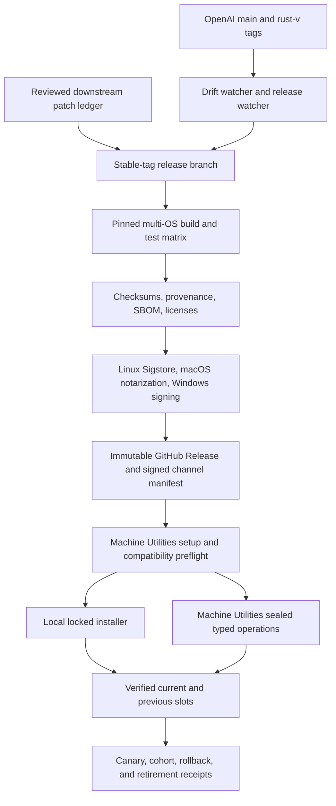

# Multi-Account Fleet Execution - Plan

## Goal Capsule

- **Objective:** Let every participating task-owning Codex host enroll multiple ChatGPT subscription accounts, route each new task to an eligible account, retain existing explicit/default local or SSH execution-environment behavior, and keep the task visible and resumable through the same per-host task store, Desktop, CLI, SSH, and Remote Control surfaces.
- **Authority:** The Product Contract owns behavior and scope. Session-settled Product and Technical Decisions override inferred assumptions. Repository guidance and current app-server v2 conventions constrain implementation details.
- **Execution profile:** Fetch both remotes. Author each isolated ledger patch from its selected OpenAI upstream base, then publish its reviewed protected patch ref; ordinary integration branches start from or rebase onto current downstream `novotny/main` and consume those refs. Deliver the narrow patch stack in dependency order. Route every work-starting action through the released `agent-utilities/model-routing/v1` contract and consume its model, effort, transport, budget, and fallback decision without copying operational constants into this plan. Reuse the existing auth storage, thread store, app-server v2, `EnvironmentManager`, and Remote Control transport before adding new machinery. Pin release candidates to a reviewed stable upstream tag after the main-based development patch is proven.
- **Stop conditions:** Run U0 before the generalized implementation. Stop before U1 if the official phone cannot match the baseline control-account surfaces for a secondary-executed ordinary task, or if no stable provider identity claim supports durable binding. Stop public distribution if service authorization or naming is not cleared. Stop live automatic routing and reassess if a subscription is flagged, suspended, or specially throttled in response to the private proof. Do not bypass any gate with credential copying, shared SQLite, a hidden transcript, or an account-unaware runtime.
- **Tail ownership:** Completion includes migration safety, generated protocol schemas, focused and full test gates, Desktop/runtime compatibility proof, fleet smoke tests, rollback instructions, and license/notice hygiene.

---

## Product Contract

Product Contract changed: R25 and R29-R41 add the user-directed maintained-fork operations, one-step setup, compatibility, supply-chain, fleet-rollout, and retirement completion conditions; R1-R24 and R26-R28 retain their prior scope.

### Summary

Add N-account execution profiles to one real `CODEX_HOME` on each host, keep one distinguished control profile for Remote Control, and bind every ordinary task to a durable execution profile and workspace account.
Route new tasks across eligible accounts while preserving existing explicit/default local and SSH execution-environment selection, without splitting the host's rollout files or SQLite index.

### Problem Frame

Codex currently treats authentication as process-global even though task history, app-server state, and Remote Control already have independent lifecycles.
Using a different `CODEX_HOME` for each subscription isolates credentials, but it also fragments sessions, configuration, task indexes, and the Desktop/phone view that the user is trying to unify.

The second pain is capacity continuity: one subscription can reach a usage limit while another paid subscription remains available, forcing manual logout/login and risking account drift on existing tasks. New-task routing should use independently enrolled subscriptions without exceeding either account's service-reported limits or changing an existing task's identity.

The fleet also has two distinct host concepts.
The app-server host owns the task and its `CODEX_HOME`; an execution environment is where commands, files, skills, and MCP processes run.
The open-source runtime can route the latter through `EnvironmentManager`, including SSH-backed exec servers, but the closed Desktop client owns which app-server connection creates a task.

The product therefore needs to separate three identities explicitly: task-owning app-server host, execution environment, and execution subscription account.

### Actors

- A1. **Fleet owner:** Enrolls accounts on hosts, designates the control profile, configures project eligibility, and manages releases.
- A2. **Desktop/CLI operator:** Starts, resumes, forks, and monitors tasks from a connected host.
- A3. **Remote operator:** Uses the official phone or another signed-in controller to inspect and continue tasks through Remote Control.
- A4. **Codex task and subagents:** Use the task's persisted execution account and environment without silently changing identity.
- A5. **Fork maintainer:** Rebases the downstream patch, publishes signed binaries, verifies Desktop compatibility, and preserves licensing obligations.

### Requirements

**Account identity and enrollment**

- R1. Each host has one real `CODEX_HOME` for configuration, sessions, archived sessions, memories, packages, and the local SQLite state/index.
- R2. A host may enroll any number of named execution profiles without hard-coded emails, organizations, or host names; credentials remain isolated and host-local. Server-generated immutable opaque IDs, never labels or account strings, identify profile storage.
- R3. An existing ChatGPT OAuth root credential becomes a stable implicit legacy profile and the initial default/control profile; later role changes do not change its identity. API-key or unauthenticated roots create no implicit subscription profile: legacy continuation first requires local enrollment and explicit binding, and Remote Control requires an enrolled OAuth control profile.
- R4. Every participating app-server host can enroll the same logical subscriptions independently; no account is permanently pinned to one host.
- R5. Account management supports add, list, reauthenticate, select default execution profile, designate control profile, drain, and logout/remove while retaining immutable, non-secret historical identity tombstones. Profile IDs are never reused; duplicate enrollment of the same provider identity reuses or rejects the existing record, and reauthentication as a different identity creates a new profile.
- R6. OAuth consent, MFA, CAPTCHA, password entry, credential revocation, destructive removal, and changing the control identity remain local human-confirmed actions unavailable to Remote Control or agent tools.

**Task persistence and identity**

- R7. Routed work is always an ordinary durable Codex task in the owning host's existing rollout tree and thread store; no shadow transcript or hidden worker task is introduced.
- R8. A task persists an opaque execution-profile ID, the U0-validated non-reversible local provider-identity fingerprint, and server-validated workspace-account ID as canonical rollout metadata, with nullable SQLite projection fields for listing and recovery. New tasks write this in `SessionMeta`; a dedicated appended binding record makes the first legacy continuation durable without rewriting its original first line.
- R9. Resume uses the persisted binding. Forks and subagents inherit it unless a later explicit migration feature creates a new task.
- R10. Draining excludes a profile from new tasks but allows its existing tasks to continue. Missing, reauth-required, logged-out, tombstoned, identity-mismatched, or permanently failed credentials block outbound work with an actionable error; Codex never silently substitutes another account.
- R11. On first continuation, a legacy task with no binding uses the stable implicit OAuth profile when one exists, or requires an explicit locally enrolled subscription profile when it does not, then appends that exact binding before any outbound request; changing default/control roles cannot change later resume identity.
- R12. App-server task responses use an explicit allowlist: opaque profile ID, owner-chosen non-PII label, lifecycle/health, opaque workspace ID, owning-host ID, and environment ID. Local management may resolve richer workspace display data; Remote Control, tasks, diagnostics, rollouts, and SQLite receive no email, organization name, raw provider subject, or credential material.

**Control plane and client parity**

- R13. Remote Control enrollment, pairing, refresh, device listing, and control-plane account state always use the designated control profile.
- R14. Model requests, model availability, token refresh, thread-scoped MCP work, and OpenAI-backed extensions use the task's execution profile.
- R15. A secondary-executed task signed into the control account must match the U0 primary-task baseline on these exact official surfaces: phone host discovery, the owning host's Remote Control task list, task detail with streaming/steer/interrupt/resume, and the control-account Recent and Projects surfaces wherever the baseline ordinary Remote Control task appears. The currently connected Desktop must also list/read/resume it. Transient connection-only visibility does not pass; cross-host merged search and notifications remain deferred.
- R16. The same forked binary supplies Desktop app-server, CLI, TUI, exec, SSH-hosted app-server, daemon, and Remote Control behavior on every supported host.
- R17. The unmodified official Desktop may use the forked runtime through its external CLI path override, but v1 does not promise a native Desktop account picker or badge that the closed client does not render.

**Routing and fleet behavior**

- R18. New-task routing supports explicit profile selection, a fixed default, and deterministic least-recently-used round-robin among eligible healthy profiles; an eligible explicit selection always wins over automatic routing.
- R19. Profile-specific rate-limit snapshots may refine new-task selection only after their freshness and account ownership are proven; missing or stale usage data is lower-confidence capacity, never unlimited capacity.
- R20. The directly connected Desktop/CLI/SSH app-server host owns the task and selects an enrolled profile by server-enumerated workspace membership, lifecycle state, and observed health. It independently selects an execution environment by canonical project root and observed health; explicit inputs can choose only eligible values.
- R21. Within one owner host, duplicate enrollment of the same provider identity never creates extra scheduler candidates. Across independent owner hosts, enrollment never advertises synthetic extra quota: service-reported per-account limits remain authoritative, while fleet-wide claim coordination is deferred with the broker.
- R22. V1 does not add a second scheduler for execution environments. It preserves explicit client selection and the existing configured/default local or SSH-backed environment, persists the latest environment ID for cold resume, permits reconnect of that same ID, and forbids automatic migration to another ID. An explicit turn override may change environments without changing the account binding.
- R23. Each host can still act as an independent task-owning app server when reached directly through Desktop SSH, CLI, or Remote Control.

**Operations and productization**

- R24. Multiple processes sharing one host home coordinate profile lifecycle, cache invalidation, request leases, and scheduler selection through durable transactions or fresh reads. A completed logout/remove cannot leave another process using the removed credential, and a scheduler claim is revalidated before the first generative request.
- R25. Isolated ledger patch-authoring branches start from a freshly fetched selected `openai/codex` base and are published as protected fork refs only after review; ordinary feature/integration branches start from or rebase onto current `novotny/main` and consume those reviewed refs. Private fleet candidates pin a reviewed stable upstream tag and carry the narrow patch queue, compatibility CI, generated schemas, signed artifacts, build provenance, an SBOM/license bundle, and two-slot fork rollback. Only signed profile-aware fork builds access the live home; emergency history access uses Machine Utilities `recover-export`, never an account-unaware Codex runtime.
- R26. The fork preserves Apache 2.0 `LICENSE` and `NOTICE` obligations, marks downstream changes, audits third-party notices, does not redistribute the closed Desktop application, and uses a neutral product name unless OpenAI trademark permission is obtained.
- R27. Public distribution is gated on a separate service-authorization review for first-party subscription OAuth; this does not block private proof or the generic local architecture.
- R28. `origin/main` remains the read-only OpenAI upstream reference and `novotny/main` is the canonical downstream integration branch containing the reviewed fleet patch and this plan. A daily scheduled sync fetches both remotes, creates a dated `codex/upstream-sync-*` branch from `novotny/main`, merges the fetched `origin/main` without rewriting published downstream history, runs the minimum affected compatibility and schema gates, and opens or refreshes one reviewable PR into `novotny/main`. The job never force-pushes `main`, never resolves conflicts or accepts generated diffs unattended, and never promotes a failing sync. Feature branches rebase on the latest downstream `novotny/main` before merge; release records pin both the incorporated upstream commit and downstream commit range.
- R29. A separate scheduled release watcher detects new or mutated upstream `rust-v*` tags and GitHub releases, records the peeled commit, draft/prerelease state, asset digests, and prior observation, and never advances a stable fork channel to an alpha, beta, deleted, or rewritten upstream release without an explicit reviewed pin.
- R30. The maintained downstream delta has one ordered executable patch ledger. Each non-merge entry records its immutable protected source ref and commit, source parent, dependencies, `git patch-id --stable`, SHA-256 of canonical `git format-patch` bytes, purpose, owning subsystem, upstreamability, test map, expected post-apply tree digest, and replacement or retirement condition. `novotny/main` continuously merges upstream main for drift detection, while each fork release branch starts from its selected immutable upstream stable tag and reapplies and verifies only the reviewed ledger without rewriting published downstream history.
- R31. Upstream conflicts and API, protocol, schema, state-migration, installer, updater, Desktop-adapter, or release-workflow drift stop automation at a reviewable branch. Generated output is regenerated from the resolved source and reviewed as output; automation never chooses a conflict side, edits the patch ledger, changes a migration, or promotes a candidate with unknown compatibility.
- R32. Release CI builds and tests macOS, Linux, and native Windows artifacts for every supported fleet architecture from a pinned source commit, Rust toolchain, lockfile, action revision set, binary-input digest set, and declared runner image. A release receipt records every input and output digest. Two rebuilds use separate fresh runner instances without shared mutable caches or signing credentials and compare normalized unsigned payloads; same-trust-domain results are labeled repeatable, and the project does not claim reproducibility for a target until independent evidence proves it.
- R33. Every private or public fork release retains its GitHub Actions build subjects for the configured evidence period and copies build inputs, both rebuild receipts, transformation/package receipts, provenance and SBOM bundles, trusted-root snapshots, signing/notarization evidence, checksums, notices/licenses, compatibility metadata, and the aggregation receipt into a durable GitHub Release. Fork publication enables GitHub immutable releases, assembles and independently verifies a draft, publishes once, and forbids asset overwrite; any rerun increments the downstream revision. Provenance follows the exact unsigned-build -> signed/notarized component -> installer-consumed archive subject graph, and the final-archive SBOM reconciles Cargo features and lockfile plus every bundled helper. Linux carries a verifiable Sigstore bundle, the exact macOS installer-consumed outer artifact is Developer ID signed, notarized, and stapled, and Windows uses a fork-owned trusted signing identity. Any incomplete target remains quarantined and cannot enter a channel.
- R34. An immutable content-addressed fork release manifest binds fork version, upstream tag and commit, downstream patch-ledger digest, target triple, minimum OS, libc/static ABI, CPU features, package format, artifact hashes, signing identities, the complete provenance/SBOM/license graph, app-server schema digest, readable/writable state-schema ranges, tested Desktop builds, required feature capabilities, and compatible Agent Utilities and Machine Utilities contract ranges. Each signed `stable` or `canary` envelope is published once as an immutable GitHub channel-event release/tag `fork-channel-<channel>-<zero-padded-sequence>` and contains channel, sequence, issue/expiry times, signer epoch, previous-envelope digest, and release-manifest digest. Authenticated clients enumerate those events in the fixed repository, verify candidate name/signature/chain/expiry, and select the highest acceptable sequence above local high-water; no mutable `latest` object is authoritative. Exact pins resolve the immutable manifest directly. Rollback is a newer channel event plus approval receipt.
- R35. The ordinary first-run experience is: install the owning plugin, invoke one setup skill, confirm scope, complete local human-only trust, repository-authentication, quit/relaunch, and OAuth steps, and receive a working fork. Phase A persists an owner-only sealed expiring transaction receipt and returns the exact relaunch/resume action; Phase B resumes that same transaction after stock Codex exits, including after parent death or reboot. The operator performs no manual source build, archive download, extraction, binary placement, PATH edit, Desktop-path edit, credential copy, or plugin-cache edit; the skill delegates runtime mutation only to Machine Utilities, and repeat/resume is idempotent.
- R36. Setup, update, repair, rollback, status, and retire reuse the repository's locked, staged, versioned native installer layout with explicit `current` and `previous` verified slots, owner-only highest-seen channel/signer state, and a content-addressed download cache outside plugin caches and `CODEX_HOME` credential state. Network, authorization, verifier, or metadata failure keeps the current slot unchanged. Offline setup may activate only an exact cached pin whose complete trust/revocation snapshot is unexpired and within the signed `offline_max_age`; after expiry, only an explicitly approved emergency reactivation of an already verified local `previous` slot is allowed. Missing, corrupt, revoked, incompatible, replayed, frozen, chain-broken, or stale entries fail closed.
- R37. Compatibility is probed from the staged binary before activation and rechecked during app-server initialization before any live state database opens or migrates. A single-use Machine Utilities activation lease binds expected candidate, launcher, client tuple, and transaction; only its supervisor may commit or restore slot pointers. An ordinary incompatible connection receives an error and no mutation authority. The tuple includes target/ABI fields from R34, fork/upstream/schema/state identity, client/Desktop, daemon, plugin/skill contracts, and capabilities. Preflight rejection leaves `current` unchanged; actual mismatch exits before state access and the activation supervisor restores `previous`. Automatic promotion requires `previous` to read/write resulting state; other migrations need separately approved snapshot/restore and cannot claim automatic rollback. Older clients keep legacy behavior without profile fields; no account-unaware runtime opens a live multi-account home.
- R38. Agent Utilities owns model/orchestration policy and delegates host readiness and mutation to Machine Utilities. Before a native action, every work-starting dispatch resolves the released router's immutable decision, satisfies configured admission, claims dispatch, and consumes one-use visible-task authority for task creation. The public routing CLI cannot mint that authority or import Codex/native receipts and must fail closed when host-owned attestors are unavailable. After the action, the fixed host importer verifies and reconciles the bound native receipt; missing or mismatched importer evidence blocks settlement and dependent work. Machine Utilities adds a narrowly typed fork-runtime status/plan/setup/update/rollback/recover-export/retire contract that binds host identity, channel or exact release, manifest/artifact digests, current/previous state, activation lease, fresh preconditions, approval, and post-state. Phase A provisions an installer-owned stable `codex-fork-recovery` entry point from the released Machine Utilities payload after integrity verification; it contains no absolute plugin-cache path and can resume a sealed transaction, roll back, or run `recover-export` without a Codex process. Recovery runs only with Codex stopped, exports allowlisted rollout/history files to an owner-only archive, excludes auth roots/mutable databases, scans credential/PII canaries, and emits a secret-free receipt. Agent Utilities never downloads or places binaries, and generic plugin refresh or `codex update` never implies fork-runtime authority.
- R39. Fleet rollout uses one exact canary, then explicit cohorts, then the remaining approved hosts. Each host returns a secret-free receipt for inventory, compatibility, active/previous release, launcher resolution, native smoke tests, official-client proof where applicable, and rollback. Any ambiguous or failed canary stops promotion, preserves partial evidence, and leaves later hosts unchanged; native Windows evidence is never inferred from WSL.
- R40. Sustained operation includes scheduled upstream-main intake, upstream-release detection, dependency and supply-chain review, attestation/signing expiry and revocation checks, cache/channel health, compatibility-matrix refresh, and rollback-drill freshness. Scheduled automation is evidence-only: it may open a review item or sealed proposal but cannot mutate hosts. A separately approved Machine Utilities canary/rollback performs the drill and returns its receipt. Retirement occurs only after upstream adoption or an explicit shutdown decision, successful official-runtime migration and rollback proof, fleet exit from fork channels, preserved credential/task data, and an auditable final release record; destructive cache or fork-state cleanup remains separately confirmed.
- R41. Every fork release has a collision-free downstream identity `<upstream-semver>-novotny.<revision>` and tag `fork-v<downstream-version>`, where revision increases monotonically for rebuilds of the same upstream base. The deterministic release-identity ledger step updates and verifies the Cargo workspace/lockfile and every generated/reporting surface, and the executable `--version`/app-server identity, release manifest, installer slot, compatibility receipt, and rollback record agree on that identity. Fork automation may read OpenAI `rust-v*` tags as immutable source metadata but never publishes fork tags, artifacts, channels, updater resolution, npm, WinGet, R2, or product-site state under OpenAI namespaces.

### Key Decisions

- **One home per host** (session-settled: user-directed — chosen over separate `CODEX_HOME` values: separate homes split the SQLite/task universe the feature is meant to preserve). Governs R1, R7, R8, R11, R24.
- **Every participating host may enroll every account** (session-settled: user-directed — chosen over pinning one account to the Mac Mini or to SSH: either account must be usable from any participating machine). Governs R2, R4, R18, R23.
- **Tasks remain visible ordinary tasks** (session-settled: user-directed — chosen over off-book workers or transcript forwarding: secondary-account work must stay visible and resumable). Governs R7, R12, R15.
- **Control identity is separate from execution identity** (session-settled: user-directed — chosen over account-pinned Remote Control or SSH transports: the primary control plane must remain stable while task execution can use either subscription). Governs R13-R16.
- **Paid-account routing is a supported product behavior** (session-settled: user-directed — chosen over a blanket ban on automatic routing: separately enrolled paid accounts are not assumed to be circumvention). Governs R18-R21. Public positioning still honors each account's own limits and passes the review in R27.
- **Downstream fork first, upstreamable seams where practical** (session-settled: user-directed — chosen over depending on an upstream pull request: OpenAI does not reliably accept third-party feature PRs on the required timeline). The private fork is the delivery path; narrowly separable protocol/persistence changes may still be proposed upstream later to reduce rebase cost, but upstream acceptance never blocks this plan.

### Key Flows

- F1. **Enroll an execution profile on a host**
  - **Trigger:** A1 adds a profile through app-server or CLI.
  - **Steps:** Codex creates a server-generated, expiring, single-use enrollment attempt bound to the intended profile operation and OAuth state/device code. On completion it verifies the U0-characterized provider identity, stores credentials under the isolated auth root, derives workspaces from the service, and leaves control unchanged. Replay, expiry, cancellation, or a swapped completion fails before storage; duplicate identity enrollment reuses or rejects the existing record.
  - **Outcome:** The host reports the profile as eligible or as needing a specific follow-up action.
  - **Covered by:** R1-R6, R24.
- F2. **Start an automatically routed task**
  - **Trigger:** A2 starts a task without an explicit profile or environment.
  - **Steps:** The app server reached directly by Desktop, CLI, SSH, or Remote Control becomes the owner. It selects an eligible profile and uses the client's explicit or existing configured/default execution environment. A profile-specific model-catalog preflight may run after identity selection; Codex persists the canonical binding before the first generative turn request, then starts one ordinary task.
  - **Outcome:** One durable task appears in normal lists and all requests use its bound identity.
  - **Covered by:** R7-R10, R12, R18-R22.
- F3. **Resume, fork, or spawn a subagent**
  - **Trigger:** A2, A3, or A4 continues an existing task.
  - **Steps:** Codex reads the canonical binding, resolves the same profile, restores the sticky environment, and rejects continuation with a targeted recovery message if the profile is unavailable.
  - **Outcome:** Identity does not drift across lifecycle boundaries.
  - **Covered by:** R8-R11, R14, R22.
- F4. **Control secondary-account work from the phone**
  - **Trigger:** A3 opens the task through Remote Control signed in as the control account.
  - **Steps:** Remote Control authenticates with the control profile, lists the owning host's ordinary thread store, and relays task requests while the task's model traffic continues through its execution profile.
  - **Outcome:** The phone can discover, stream, steer, interrupt, and resume the secondary-executed task without changing enrollment.
  - **Covered by:** R13-R16.
- F5. **Drain, reauthenticate, or remove a profile**
  - **Trigger:** A1 changes profile state or authentication fails permanently.
  - **Steps:** `active -> draining` excludes new tasks while existing tasks continue. `active|draining -> reauthRequired` blocks outbound work until the same provider identity reauthenticates. Logout deletes only that profile's secrets and blocks bound tasks; tombstoning retains minimized non-secret identity metadata. Logout/removal/tombstoning of the control holder is refused until F7 succeeds; control reauth failure blocks Remote Control with local recovery guidance. Removal reports affected-task counts and requires confirmation.
  - **Outcome:** Existing task identity remains explainable and no task is silently rerouted.
  - **Covered by:** R5, R6, R9, R10, R24.
- F6. **Update or roll back the forked runtime**
  - **Trigger:** A5 refreshes the development branch from upstream main or prepares a release from a stable upstream tag.
  - **Steps:** The maintainer integrates upstream main through R28's review branch, constructs a release from the pinned stable tag plus patch ledger, and runs the affected compatibility/schema gates. A canary validates Desktop, CLI, SSH, and Remote Control; rollout advances or atomically switches the managed path to the previous signed profile-aware fork build. If both fork slots fail, stop Codex execution and use Machine Utilities `recover-export` for read-only inspection.
  - **Outcome:** An upstream or Desktop incompatibility cannot strand every host.
  - **Covered by:** R16, R17, R25-R41.
- F7. **Reassign the control profile**
  - **Trigger:** A1 explicitly selects a different active ChatGPT profile as control.
  - **Steps:** Codex proves a new Remote Control enrollment first, compare-and-set updates the single control role, restarts the app-server/daemon in v1, and removes the old enrollment only after the new one is healthy. Failure rolls back the role and keeps task bindings unchanged.
  - **Outcome:** The fleet reconnects after the deliberate restart without losing enrollment or rebinding execution tasks.
  - **Covered by:** R5, R6, R13, R24.
- F8. **Ingest upstream and prepare a release candidate**
  - **Trigger:** The scheduled watcher observes upstream main drift or a new stable `rust-v*` release.
  - **Steps:** Continuous integration records and tests the upstream-main delta on a review branch. Stable release preparation starts from the selected tag commit, applies the ordered patch ledger, regenerates schemas, resolves conflicts through review, and emits an immutable source receipt.
  - **Outcome:** The candidate has an inspectable upstream base, downstream patch identity, drift disposition, and test scope before any release build starts.
  - **Covered by:** R28-R32, R40.
- F9. **Build, attest, sign, and publish a fork release**
  - **Trigger:** A reviewed release candidate is approved for the private fleet or public distribution.
  - **Steps:** Fork-owned CI builds and tests every required target, inventories binary inputs, compares independent normalized rebuilds, records the unsigned-to-signed-to-final-archive subject graph, emits checksums, provenance, reconciled SBOM/license assets, and compatibility metadata, then signs/notarizes platform artifacts. The aggregator copies every receipt and offline verification object to a draft GitHub Release, verifies downloaded bytes, publishes once, and creates the next signed channel envelope only for a complete target set.
  - **Outcome:** Setup consumes one signed manifest that resolves only complete, compatible, attributable artifacts.
  - **Covered by:** R25-R27, R32-R34.
- F10. **Install, update, or roll back through setup**
  - **Trigger:** A local operator explicitly approves one setup, update, repair, rollback, or retirement plan. Policy and pinned-channel checks produce evidence or proposals only.
  - **Steps:** The fresh approval binds the exact plan ID, host targets or cohort, channel or pin, current/previous digests, operation set, and rollback boundary. Phase A proves native secure credential storage, authenticates the dedicated repository account, verifies/caches/stages the release, configures the managed launcher, installs the verified stable recovery entry point, and seals an expiring transaction receipt without opening/migrating the live home. After every stock owner quits, the exact relaunch action resumes Phase B through the skill or recovery entry point. Machine Utilities creates the single-use activation lease, supervises the U11 pre-state probe and actual initialize, and alone commits or restores `current`/`previous`; the app-server never owns pointer authority. Allowed migration/enrollment then completes and invalidates the receipt. Update, interrupted resume, reboot, and rollback use the same transaction boundary.
  - **Outcome:** The active runtime changes without manual binary handling, credential movement, task-store replacement, or channel drift.
  - **Covered by:** R34-R39.
- F11. **Promote a release across the fleet**
  - **Trigger:** A release is signed, compatible, and selected for fleet rollout.
  - **Steps:** Task Orchestrator creates and monitors fresh authority-backed host-local Machine Utilities child tasks but never runs status, seal, apply, rollback, or recovery actions itself. Each remote operation uses fresh project matching and a new visible task. Machine Utilities seals exact per-host operations, and one canary advances first. After native and official-client evidence passes, explicit cohorts advance. Any failure stops later cohorts and preserves current/previous slots plus partial receipts.
  - **Outcome:** Fleet state is explainable per host and a failed release does not become fleet-wide.
  - **Covered by:** R38-R40.
- F12. **Retire the fork or adopt upstream behavior**
  - **Trigger:** Upstream ships equivalent behavior or the owner decides to end the fork.
  - **Steps:** The maintainer proves feature, state, installer, update, and rollback compatibility with the official runtime; canaries exit fork channels; the fleet follows in cohorts; fork-owned runtime state becomes cleanup-eligible only after task and credential preservation is verified.
  - **Outcome:** The official runtime resumes without data loss, silent account rebinding, or an orphaned updater/trust root.
  - **Covered by:** R37-R40.

### Acceptance Examples

- AE1. **Unified local history:** Given two enrolled profiles in one host home, when each starts a task, then `thread/list` returns both from the same store and both survive app-server restart.
- AE2. **Sticky account:** Given a task bound to profile B, when it is resumed, forked, and used to spawn a subagent, then all model requests carry profile B's account/workspace identity.
- AE3. **Lifecycle semantics:** Given profile B is drained after task creation, its existing task continues but no new task selects B. Given B becomes reauth-required or logged out, resume blocks with the exact recovery action and never uses A.
- AE4. **Primary control, secondary execution:** Given U0 records the official surfaces for a primary-executed ordinary Remote Control task, Remote Control is enrolled with A, and a task is bound to B, then the secondary task matches that baseline on host discovery, owning-host task list, task detail/control verbs, applicable control-account Recent/Projects views, and connected-Desktop list/read/resume; control traffic stays on A and model traffic on B through independent refreshes and restart.
- AE5. **Round-robin:** Given two equally weighted eligible healthy profiles, when four new tasks start, then selection alternates deterministically even across two app-server processes sharing the home.
- AE6. **Quota uncertainty:** Given one fresh healthy snapshot and one stale/failed snapshot, when automatic routing runs, then the fresh profile is preferred and the stale profile is not treated as unused capacity.
- AE7. **Owner/environment parity:** Given Desktop or CLI connects directly to H, H owns the task and must have its selected profile. An explicit or configured/default SSH environment with the canonical project root may execute tools without subscription credentials; v1 does not automatically choose among otherwise eligible environments.
- AE8. **Environment outage:** Given a selected environment disconnects before the first turn or mid-task, the task remains bound and reports a recoverable error. Automatic reconnect may restore the same environment ID; only an explicit turn override may select another ID.
- AE9. **Legacy migration:** Given a pre-feature task and the implicit legacy profile, when default/control roles change before its first upgraded resume, then the resume appends the legacy profile binding before outbound work and later SQLite rebuild/restart/reauth resolves the same identity without rewriting earlier lines.
- AE10. **Runtime rollback:** Given a Desktop/app-server protocol smoke test fails after an update, switching to the previous signed profile-aware fork restores full operation. If both slots fail, execution stays stopped and Machine Utilities `recover-export` provides the credential-scanned read-only history artifact.
- AE11. **Atomic control reassignment:** Given active tasks and control profile A, changing control to B succeeds only after B's enrollment is healthy and a daemon restart completes; failed pairing or restart leaves A in control and never changes task bindings.
- AE12. **Cross-process invalidation:** Given processes P1 and P2 share the home, after P1 logs out or removes profile B successfully, P2 cannot issue another request with B; concurrent role and scheduler updates fail closed on stale versions.
- AE13. **No implicit OAuth profile:** Given a pre-feature task on an API-key or unauthenticated root, its first upgraded continuation stops before outbound work, requires local ChatGPT OAuth enrollment and explicit profile selection, appends that exact binding, and later restart/reindex resumes only that profile.
- AE14. **Daily upstream integration:** Given new commits on `origin/main`, when the scheduled sync runs, then it produces one dated branch and PR whose receipt records the old/new upstream tips, downstream base, merge result, changed subsystem map, focused gates, generated-file status, and unresolved conflicts. A clean passing sync may be merged into `novotny/main`; a conflict, schema drift, or failed gate leaves downstream `main` unchanged and requires a bounded human resolution.
- AE15. **Stable release detection:** Given a new upstream stable tag and an unrelated alpha tag, the watcher records both but proposes only the stable tag. If the tag object, peeled commit, or published asset digest later changes, the watcher raises a blocking mutation finding instead of advancing a channel.
- AE16. **Patch-ledger release base:** Given `novotny/main` has merged commits newer than the selected upstream stable tag, a fork release starts from that tag and applies the reviewed ordered patch ledger. Its receipt identifies the tag commit, patch IDs, resulting commit, schema digests, and any revised patch caused by conflict resolution.
- AE17. **Reproducible build claim:** Given two fresh independent runner instances use the same recorded inputs without shared mutable caches or signing credentials, normalized unsigned payloads match for each target that is declared reproducible. A same-trust-domain match is labeled repeatable; any mismatch blocks that target and downgrades the claim without hiding platform signatures or timestamp differences behind normalization.
- AE18. **Complete supply-chain set:** Given one target lacks its required signature, provenance, SBOM, license bundle, notarization, or trusted build receipt, publication may retain quarantined Actions artifacts but no release channel references that target or release.
- AE19. **One-step first run:** Given stock Codex and the owning plugin on a clean host, setup Phase A touches no profile state, installs the verified stable recovery entry point, seals an expiring transaction, and returns the relaunch/resume action. After every stock owner stops, the same skill or entry point resumes Phase B under the single-use activation lease and passes smoke tests without manual binary handling. Parent death/reboot is repeatable; stale, replayed, or mismatched receipts fail closed.
- AE20. **Compatibility block:** Given a candidate whose Desktop build, app-server schema, state write range, plugin contract, OS, or architecture is not allowed by the signed manifest, setup leaves the candidate staged, retains the active slot, and reports the exact incompatible tuple.
- AE21. **Offline and cache behavior:** Given the network and release metadata are unavailable, an exact cached signed compatible pin may install only while its complete trust snapshot is unexpired and within `offline_max_age`. After expiry, the current runtime may continue and an explicit emergency action may reactivate an already verified local `previous`, but no newly cached release activates. Missing, corrupt, revoked, replayed, frozen, chain-broken, or digest-mismatched state leaves the host unchanged and never launches an upstream runtime against the live home.
- AE22. **Atomic update and rollback:** Given concurrent setup processes or a smoke failure after staging, one lock owner completes, `current` and `previous` never point to partial content, and automatic rollback emits one receipt. If neither slot verifies, fork execution stops while credential-free history inspection remains possible.
- AE23. **Fleet canary:** Given an approved multi-host release, exactly one canary advances and returns native platform plus official-client evidence before any cohort begins. A canary or cohort failure stops later hosts, preserves per-host partial results, and does not infer native Windows success from WSL.
- AE24. **Upstream adoption:** Given upstream ships equivalent behavior, retirement proves task/account/state compatibility and a reversible official-runtime canary before fleet promotion. Cleanup removes only confirmed fork-owned runtime/cache state and never removes credentials, rollouts, SQLite, or unrelated plugin state.

- AE25. **Downstream release identity:** Given two fork releases from the same upstream stable tag, they receive increasing `-novotny.N` versions and distinct immutable tags, slots, manifests, receipts, and rollback targets. Every executable and protocol identity reports the selected downstream version, and no fork job writes an upstream or OpenAI publisher namespace.
- AE26. **Trust bootstrap and channel resistance:** Given a clean native host with no preinstalled `gh` or Cosign, setup bootstraps only the pinned verifier/downloader digests carried by the released Machine Utilities integrity chain, obtains least-privilege repository authority into the OS credential store, verifies the fixed workflow identity, and persists owner-only channel high-water state. Missing or expired authorization, verifier absence, replay, freeze, forked envelope history, clock skew, signer-epoch rollback, or unapproved root rotation cannot change `current` or leak a token.
- AE27. **State-safe compatibility rejection:** Given the activation supervisor launches a staged runtime and an actual tuple is incompatible, every app-server entry path rejects before state access, emits a mismatch receipt, and the supervisor—not the client—restores `previous`; all state-file digests remain unchanged. A later ordinary incompatible connection only errors and cannot change pointers. A migration outside the read-write intersection requires approved snapshot/restore and never enters an automatic channel.
- AE28. **Both-slots recovery:** Given both slots are invalid and Codex is stopped or absent, the installer-owned integrity-checked `codex-fork-recovery` entry point invokes Machine Utilities `recover-export` without resolving plugin-cache paths, copies only allowlisted rollout/history material to an owner-only archive, excludes auth roots/mutable databases, passes credential/PII-canary scanning, and emits a receipt without executing either Codex binary.

### Success Criteria

- The real two-account, multi-host matrix passes AE1-AE13 without copying tokens or state databases.
- Secondary-executed tasks remain visible in official phone and Desktop task views under the control account.
- Before fleet rollout, each owner host's machine-readable account-session list proves the intended logical profiles are enrolled, healthy, and correctly assigned to control/default roles; external fleet tooling may aggregate these per-host reports without receiving credentials.
- Focused Rust suites, generated schema checks, migration recovery tests, and the approved full workspace suite pass.
- A latest-main development refresh and a stable-tag release rebase both reproduce from the patch ledger, and AE14-AE28 pass through unique downstream versioning, trust bootstrap, one-step setup, signed publication, compatibility, cache/offline, canary, recovery, rollback, and retirement proof.

### Scope Boundaries

**In this plan**

- Multiple execution profiles in one per-host home, task binding, account lifecycle, account-aware model and extension traffic, control/execution separation, new-task account routing, existing execution-environment parity, official-client proof, and the complete private-fleet fork lifecycle from upstream intake through retirement.

**Deferred to follow-up work**

- Automatic selection of which app-server/`CODEX_HOME` owns a new task, cross-host scheduler claims, cross-host merged search/notifications, and a custom fleet broker. Stock Desktop connection selection is outside this repository. U0 still requires secondary tasks to match whatever control-account Recent/Projects surfaces an ordinary owning-host Remote Control task receives today.
- Automatic execution-environment selection beyond existing explicit/configured-default behavior.
- Native account/host pickers or badges inside the closed official Desktop UI. V1 exposes additive route metadata for clients that can render it and automatic behavior for clients that cannot.
- Mid-task account failover or migration. A future migration must create an explicit fork/new task with a new binding and audit trail.
- Public distribution and a product name until OAuth/service authorization and trademark review are complete.
- Unattended fleet promotion without an explicitly approved channel/pin policy, cohort definition, and rollback boundary.
- A new artifact CDN, package manager, or general-purpose fleet transport while authenticated GitHub Releases, the native installer layout, and Machine Utilities typed operations cover the private fleet.

**Never**

- Synchronizing access/refresh tokens between hosts, network-sharing SQLite, inventing extra quota from per-host enrollment, exposing secrets through agent APIs, silently changing an existing task's account, or hiding routed work outside the ordinary thread store.

### Dependencies and Outstanding Questions

- **Deferred external proof:** The official phone/backend may enforce task visibility using execution-account or model-provider ownership despite the local Remote Control separation. U0 resolves this before the generalized implementation; failure means the full user outcome is blocked, and any local-only subset requires an explicit reduced-scope decision rather than silently shipping as this product.
- **Deferred client capability:** The external Desktop CLI path override is observed behavior, not a documented stable API. U0 may use a manually installed owner-controlled development build; U10 formalizes a verified managed path and two-slot rollback. If the override disappears, live-home operation stops until another profile-aware launch path exists.
- **Deferred fleet coordination:** Independent owners cannot make atomic cross-host quota claims. Each host uses service-reported limits and never invents capacity from enrollment count; global coordination waits for the broker.
- **Private-proof enforcement risk:** Separately paid accounts are not presumed to violate policy, but any account flag, suspension, or routing-specific throttle during live proof stops automatic routing pending review.
- **Deferred public release:** Apache 2.0 covers the source fork, not OpenAI service authorization or trademarks. Public binaries wait for those reviews; private implementation does not.
- **Fork-owned release authority:** OpenAI-specific runner groups, signing environments, Azure keys, Apple notarization credentials, R2, npm, WinGet, and website publication in the upstream workflows are unavailable to the fork unless separately provisioned. Private release remains blocked per target until the fork owns the required runner and signing identity; OpenAI-only publication jobs stay disabled.
- **Selected private distribution profile; entitlement proof still required:** Private releases use fixed repository `novotnyllc/codex`. A dedicated fleet GitHub account has read-only access only to that repository; setup uses browser OAuth with the pinned `gh`, records the effective broader OAuth scopes, proves a native secure backend (macOS Keychain, Windows Credential Manager, or Linux Secret Service), and fails closed if `gh` would store a token in plaintext `hosts.yml`. Repository reachability, not a fictitious OAuth scope, bounds authority. The executor resolves the credential locally without placing it in argv, sealed plans, receipts, logs, environment captures, or cache metadata. Before U9, prove GitHub Enterprise Cloud private-attestation entitlement and minimum tool versions. If entitlement fails, U9 blocks until this plan adopts an explicitly reviewed external Sigstore/SLSA profile; it may not weaken provenance or publish publicly.
- **Desktop build identity:** U11 must determine the stable platform-specific Desktop build identifier available to the app-server and setup surfaces. Until proven, compatibility uses an exact observed client name/version tuple plus black-box canary evidence and treats unknown builds as incompatible.
- **Released orchestration baseline:** Agent Utilities 0.5.10 at `beb0205e7e21160f24bad4c426365f916d2b033c`, Machine Utilities 0.2.18 at `06e12fb9dfc63a4673c771e54e1237979dd1253b`, and marketplace pin `6d3da4b3b5b165d252dd598ae052539850001b34` satisfy this plan's release prerequisite. Their final evidence was Agent Utilities 166/166, Machine Utilities normal compatibility 1/1, zero P0-P2 quality findings, and zero P0-P1 security findings. These receipts authorize no future task or host mutation; U12 still requires fresh route, authority, approval, native-readiness, and post-state evidence for each dispatch.
- **Fleet readiness limitation:** Three macOS hosts verified the released Agent Utilities and Machine Utilities versions. Iris WSL timed out twice without mutation. Iris native Windows returned `model_routing_capability_unavailable` and `trusted_task_authority_attestor_unavailable`, and no task was created. These outcomes do not block plan integration, but they remain explicit missing native evidence for any U12 Iris lane and cannot be replaced by WSL proof.

The following readiness observations are control-task handoff evidence dated 2026-08-04, not independently reproduced by this plan-only revalidation. The handoff did not supply per-host task-identity digests, native receipt IDs/digests, or a durable receipt location; U12 must capture those fields before treating any observation as mutation authority or settlement evidence.

| Target | Released runtime evidence | Terminal result | Mutation state | Evidence provenance or gap |
|---|---|---|---|---|
| Three macOS hosts | Agent Utilities 0.5.10; Machine Utilities 0.2.18 | Version verification passed | No fork-runtime mutation claimed | Control-task report; per-host identity and receipt fields not supplied |
| Iris WSL | Same release baseline intended | Two timeouts | No mutation | Control-task report; WSL is not native-Windows evidence |
| Iris native Windows | Same release baseline intended | `model_routing_capability_unavailable`; `trusted_task_authority_attestor_unavailable`; no task created | No mutation | Control-task report; native task and receipt fields absent because authority failed closed |

### Sources

- `AGENTS.md` — app-server v2, schema generation, test, platform, and repository conventions.
- `codex-rs/app-server/README.md` — app-server lifecycle, stable/experimental API rules, thread environments, Remote Control, and schema generation.
- `codex-rs/app-server-protocol/src/protocol/v2/account.rs` — existing unfinished account-session types and rate-limit data.
- `codex-rs/login/src/auth/manager.rs` and `codex-rs/login/src/auth/storage.rs` — current single-manager cache and path-derived file/keyring storage.
- `codex-rs/protocol/src/protocol.rs`, `codex-rs/thread-store/src/local/`, and `codex-rs/state/` — rollout source of truth and SQLite projection.
- `codex-rs/exec-server/src/environment_toml.rs` and `codex-rs/core/src/environment_selection.rs` — existing local/SSH execution-environment registry and sticky selection.
- `codex-rs/app-server-transport/src/transport/remote_control/auth.rs` — Remote Control's explicit `AuthManager` dependency.
- `.github/workflows/rust-release.yml`, `.github/workflows/rust-release-windows.yml`, and `.github/workflows/r2-release.yml` — current six-target build, signing, notarization, GitHub Release, R2, npm, and WinGet release topology; fork-owned infrastructure must replace OpenAI-specific publishers.
- `.github/workflows/README.md`, `.github/workflows/blocking-ci.yml`, `.github/workflows/rust-ci-full.yml`, and `.github/workflows/cargo-deny.yml` — fast PR versus heavy post-merge checks and dependency/license policy.
- `scripts/install/install.sh`, `scripts/install/install.ps1`, and `scripts/install/test_install_sh.py` — locked staged installs, verified digests, release directories, mirror fallback, and atomic active-path patterns to extend.
- `codex-rs/app-server-daemon/src/update_loop.rs`, `codex-rs/tui/src/updates.rs`, `codex-rs/tui/src/update_action.rs`, `codex-rs/tui/src/update_prompt.rs`, and `codex-cli/bin/codex.js` — upstream update paths that must not replace a forked runtime.
- Agent Utilities `plugins/agent-utilities/skills/task-orchestrator/SKILL.md`, `plugins/agent-utilities/references/model-routing.md`, and `docs/delivery-workflows.md` — model/orchestration policy and the boundary that delegates fleet readiness and mutation.
- Machine Utilities `plugins/machine-utilities/skills/fleet-agents/SKILL.md`, `plugins/machine-utilities/skills/fleet-update/SKILL.md`, `plugins/machine-utilities/integrity.json`, and `docs/architecture.md` — manager ownership, sealed plans, executor integrity, native-Windows proof, and the current prohibition on downloaded installer pipelines.
- Agent Utilities `docs/solutions/tooling-decisions/codex-only-hooks-in-dual-host-plugins.md` — loader and validator compatibility are separate gates; neither is inferred from the other.
- [GitHub build and SBOM attestations](https://docs.github.com/en/actions/how-tos/secure-your-work/use-artifact-attestations/use-artifact-attestations) and [offline attestation verification](https://docs.github.com/en/actions/how-tos/secure-your-work/use-artifact-attestations/verify-attestations-offline) — fork provenance and cached/offline verification primitives.
- [GitHub immutable releases](https://docs.github.com/en/code-security/concepts/supply-chain-security/immutable-releases) and [Actions retention settings](https://docs.github.com/en/repositories/managing-your-repositorys-settings-and-features/enabling-features-for-your-repository/managing-github-actions-settings-for-a-repository) — publish-once release behavior and why durable evidence must be copied out of expiring workflow artifacts.
- [Apple notarization requirements](https://developer.apple.com/documentation/security/notarizing-macos-software-before-distribution) — Developer ID, hardened runtime, secure timestamp, notarization, and ticket validation requirements for direct macOS distribution.
- [Microsoft SignTool verification](https://learn.microsoft.com/en-us/windows/win32/seccrypto/signtool) — native Authenticode verification semantics for downloaded Windows artifacts.
- [Codex App Server documentation](https://learn.chatgpt.com/docs/app-server) — current initialization, login, task, and rate-limit contracts.
- [OpenAI Codex releases](https://github.com/openai/codex/releases) — stable-tag and app-server compatibility baseline.
- [First-class multi-account request](https://github.com/openai/codex/issues/4432) and [multi-account rotation request](https://github.com/openai/codex/issues/9648) — issue evidence for the existing gap, not product contracts.
- [OpenAI Terms of Use](https://openai.com/policies/terms-of-use/), [Apache 2.0 license](https://github.com/openai/codex/blob/main/LICENSE), and [OpenAI brand guidelines](https://openai.com/brand/) — distribution and positioning constraints.

---

## Planning Contract

### Assumptions

- V1 adds no host load balancer: the directly connected app server owns the durable task, and execution uses the client's explicit or existing configured/default environment. Automatic owner/environment selection is deferred as stated in Scope Boundaries.
- Automatic routing plus CLI/TUI management is sufficient for v1 even though the unmodified Desktop cannot render a native picker or badge.
- A ChatGPT OAuth root credential becomes the initial control/default profile; API-key and unauthenticated roots require explicit subscription enrollment before binding.
- Public release preparation is in scope, but public distribution is not a completion requirement until external authorization and naming gates pass.
- Explicit selection and deterministic round-robin ship before adaptive quota-based routing; quota data earns influence only through tests.

### Key Technical Decisions

- KTD1. **Separate auth storage root from data home.** Add an `AuthManager` constructor that accepts an explicit auth storage root while configuration, rollouts, memories, packages, and SQLite continue to use the real home. Additional profiles live under `CODEX_HOME/auth/profiles/<validated-opaque-id>`; IDs are server-generated single path components, containment is verified, symlink roots are rejected, and labels/account IDs never become paths. Version a collision-resistant keyring namespace from canonical base home plus stable profile ID while preserving the legacy root namespace.
- KTD2. **Bootstrap one control manager and a registry of execution identities.** Construct `AuthProfileRegistry` in app-server bootstrap (`lib.rs` and `in_process.rs`) before Remote Control, then pass the same distinguished control manager to Remote Control and the execution resolver to `MessageProcessor`. Each execution identity is one matched object containing profile/workspace binding, `AuthManager`, `SharedModelsManager`, and `ProfileRequestGuard`; the guard owns request leases and final lifecycle/fingerprint validation. Make that object a required `ThreadSpawnRequest`/`SessionSpawnArgs` dependency at the core thread boundary so CLI, TUI, MCP server, exec, app-server, and in-process start/resume/fork/subagent callers cannot pair profile auth with the process-global models manager. V1 control-role reassignment uses explicit app-server/daemon restart rather than hot-swapping a live handle.
- KTD3. **Make rollout metadata canonical and recover mutable authority explicitly.** U0 first characterizes a stable provider subject and derives a non-reversible host-local fingerprint; raw account claims and display PII never enter rollouts. Add profile/workspace/fingerprint fields to new-task `SessionMeta` and an appended `SessionIdentityBinding` item for first legacy continuation; extraction resolves the immutable binding without modifying earlier lines. Project it into nullable `threads` columns. SQLite owns mutable minimized profiles/tombstones, lifecycle, eligibility, and scheduling timestamps but never tokens. Once profile state exists, app-server's corrupt-database fresh-start path enters `profile_state_recovery_required` rather than reporting an empty healthy registry. U1 chooses and proves either a durable canonical non-secret profile/tombstone journal that can rebuild SQLite or explicit backup restoration/reconstruction before routing, management, or bound resume; recovery verifies live fingerprints.
- KTD4. **Select execution identity at the core thread boundary.** `thread/start` selects or accepts an eligible profile before persistence. Cold resume resolves the saved matched execution-identity object. Fork and subagent paths inherit that same required object through `ThreadSpawnRequest`/`SessionSpawnArgs`, `Session`, `TurnContext`, MCP, and `ExtensionDataInit`; no caller may separately source a process-global models manager. Namespace model caches by profile, and never let a backend client opportunistically switch accounts.
- KTD5. **Replace the unused account-session draft with profile semantics.** Do not promote the unregistered `AccountSessions*` types, which encode one active session and a global account switch. Replace or rename them as experimental cursor-paginated `AccountProfile*` methods exposing stable profile ID, lifecycle, default/control roles, per-profile health, and only R12's allowlisted metadata. Preserve current single-account methods as an implicit-profile compatibility facade for legacy clients.
- KTD6. **Audit account-aware consumers by role without cloning global registries.** Model clients, refresh state, thread-scoped MCP, and auth-capturing web-search/image-generation/git-attribution extensions resolve thread auth. Keep the process extension registry and inject thread auth through `ExtensionDataInit`; do not build a full registry per profile. Additional profiles cannot inherit process-global API/PAT credentials unless explicitly profile-scoped. Each profile owns refresh locks, failure state, watchers, and external auth; pairing and Remote Control use control auth.
- KTD7. **Use an atomic host-local last-use claim for the first scheduler.** Equal-priority profiles select the eligible row with oldest committed `last_used_at` using lifecycle/version predicates in one SQLite transaction. Revalidate before the first generative request and never substitute. A crash may consume a fairness slot; do not race by rolling it back. An eligible explicit binding wins. Service-reported per-account limits are the only cross-host capacity signal; local fairness never implies remaining quota.
- KTD8. **Reuse execution environments without a new scheduler.** Persist complete `TurnEnvironmentSelections` through the current `ThreadConfigSnapshot` -> `ThreadSettingsSnapshot`/`ThreadSettingsApplied` seam, reconstruct the latest selection on cold resume, and use legacy `cwd` or configured-default fallback only for older rollouts. Reuse `EnvironmentManager`, explicit/configured-default selection, and SSH exec-server transports; allow same-ID reconnect and explicit turn overrides. Do not add automatic environment or task-owner selection in v1.
- KTD9. **Gate generalized work on U0.** Before U1, a disposable dual-identity spike must characterize provider identity and compare a primary-executed baseline with control-account Remote Control plus secondary-account model execution on every R15 surface. Local mock success is necessary but not sufficient; a failed full-outcome gate requires a new user scope decision.
- KTD10. **Extend the native installer as the verified compatibility adapter.** Reuse the locks, staged version directories, digest checks, mirror fallback, and atomic active-path replacement in `scripts/install/install.sh` and `scripts/install/install.ps1`. Add a fork source/channel, independently pinned trust root, explicit `current` and `previous` slots, content-addressed cache, signed-manifest verification, and Desktop/daemon resolution through the same verified active path. Patch the daemon's `CODEX_HOME/packages/standalone/current/codex` assumption and every upstream update prompt/bootstrap path so none can overwrite the fork. Only verified slots access the live home; emergency history export is inspected without an account-unaware runtime.
- KTD11. **Keep the downstream patch narrow.** Author isolated ledger patches from their selected freshly fetched upstream base and publish them as reviewed protected refs; start or rebase ordinary feature/integration branches on current `novotny/main`, and cut releases from reviewed stable tags plus the ledger. Isolate feature code in small modules, regenerate app-server/config schemas, avoid rebranding upstream source packages initially, and carry Apache/NOTICE changes in distribution artifacts rather than modifying closed Desktop assets.
- KTD12. **Make lifecycle and roles explicit.** Lifecycle is `active`, `draining`, `reauthRequired`, `loggedOut`, or `tombstoned`; control/default are orthogonal roles with exactly one valid holder when any OAuth profile exists. Local compare-and-set mutations publish cross-process invalidation before success. Reauthentication preserves an ID only when identity matches; removal reports affected tasks and keeps a never-reused minimized tombstone. The control holder cannot log out, be removed, or be tombstoned until reassignment; control reauth failure blocks Remote Control rather than failing over.
- KTD13. **Derive eligibility server-side.** Workspace IDs come from memberships enumerated by the authenticated profile, and configured project roots are canonicalized in the selected execution environment. Explicit choices win only inside that eligible set; lost membership, symlink escape, or identity mismatch fails closed with recovery guidance.
- KTD14. **Enforce local-human management at transport ingress.** Derive an unforgeable management capability from app-server `ConnectionState`/`ConnectionOrigin`, never JSON-RPC params, and propagate it through `MessageProcessor` into every request context. Direct local interactive CLI/in-process management with one-shot human confirmation may mutate accounts; Remote Control relays, task/agent/MCP/extension calls, unauthenticated local sockets, and unknown origins deny by default. Legacy endpoints obey the same matrix.
- KTD15. **Bind login completions to one attempt.** Enrollment/reauth creates an expiring single-use attempt tied to the intended operation, target profile, and OAuth state/device-code context. Replay, cancellation, expiry, concurrent swap, or different provider identity fails before credentials are stored.
- KTD16. **Serialize destructive lifecycle changes with outbound use.** `ProfileRequestGuard` uses the repository's existing file-lock primitive where possible to acquire a per-profile cross-process lease. Every model, MCP, and auth-capturing extension send holds a shared lease through final lifecycle/fingerprint validation and credential use. Logout/removal obtains the exclusive lease, cancels/drains earlier sends, commits state, invalidates caches, and deletes/revokes secrets before returning; if bounded drain cannot complete, the mutation fails without reporting success.
- KTD17. **Fail closed when mutable profile state is unavailable.** If SQLite/profile registry startup fails, automatic routing and management are disabled. Only unbound legacy tasks backed by a valid implicit OAuth profile may continue; any profile-bound start/resume returns state-recovery guidance. No path silently falls back to root auth.
- KTD18. **Keep implementation cost-first through the released router.** (session-settled: user-directed — chosen over frontier-model implementation by default: routine implementation should use the least expensive policy-approved route while stronger models remain bounded to judgments that need them.) `agent-utilities/model-routing/v1` is the only operational model, effort, budget, fallback, and transport policy. Every lane consumes its immutable route receipt and discloses requested versus actual identity; this plan does not pin provider constants or reconstruct escalation rules.
- KTD19. **Separate patch authoring from downstream integration and never rewrite main.** Keep `origin` as OpenAI and `novotny` as the maintained fork. A ledger patch-authoring branch starts at its selected upstream base so its canonical patch is isolated; after tests/review, cut the protected `refs/fork-patches/<id>/<revision>` at that exact commit. Ordinary feature/integration branches start from or rebase onto current `novotny/main` and consume reviewed patch refs. Daily automation merges fetched `origin/main` into a temporary branch and proposes that merge to downstream main. Rebase unpublished branches only; record upstream merge-base and downstream-only range.
- KTD20. **Separate drift integration from cryptographically bound release construction.** `novotny/main` continuously merges upstream main to expose conflicts early. A release branch starts from the selected immutable upstream stable-tag commit. For each ordered ledger entry, the helper resolves a protected ref, verifies source commit/parent, canonical patch bytes and stable patch ID, applies it, and compares the expected tree digest; extra diffs or unreachable/mismatched inputs stop. Conflict resolution creates a reviewed replacement commit/ref and ledger entry rather than editing automation output or cherry-picking an unexplained downstream-main range.
- KTD21. **Publish immutable channel events and bootstrap one verifier.** Each content-addressed release manifest is immutable. Each `stable`/`canary` Cosign envelope is a distinct publish-once `fork-channel-<channel>-<zero-padded-sequence>` GitHub event release/tag; authenticated discovery enumerates the fixed repository, validates event names and every candidate's signature/chain/expiry, and chooses the highest acceptable sequence above durable local high-water. Rollback publishes a newer event. The released Machine Utilities integrity chain pins target digests for minimum `gh`/Cosign binaries plus expected GitHub OIDC issuer and fork-release workflow identity. Setup downloads only fixed tools, verifies native SHA-256, then Cosign bundles; root/identity rotation requires a new plugin release and explicit local approval. Highest-seen sequence/epoch state lives outside cache and slot pointers.
- KTD22. **Build once and preserve the transformation subject graph.** Each target's unsigned payload is produced by a pinned builder and retained with its build-input receipt. Independent normalized rebuild comparison happens before signing. Build provenance names the unsigned payload; signing/notarization emits a transformation receipt binding exact unsigned input to signed output; package provenance binds signed components to the installer-consumed archive; the final-archive SBOM reconciles target Cargo features/`Cargo.lock`, bundled V8, `rg`, zsh, `bwrap`, Windows helpers, and archive membership. Signing jobs cannot rebuild or substitute bytes. The aggregator links all evidence, copies it to a draft release, verifies downloaded bytes, and publishes once only when complete.
- KTD23. **Bound reproducibility claims per target and trust domain.** The initial release contract records source, toolchain, actions, runner-image identity, lockfiles, binary inputs, environment, and commands. Rebuilds use separate fresh runner instances, no shared mutable build cache, and no signing credentials; separate runner pools are preferred. Same-trust-domain matches prove repeatability only. Byte reproducibility becomes a target capability only after independent clean normalized rebuilds repeatedly pass; signatures, notarization tickets, timestamps, and intentionally non-deterministic envelopes are compared by verified subject digest and policy rather than hidden through broad normalization.
- KTD24. **Make setup the only ordinary-user entry point and split first run at the runtime boundary.** The Machine Utilities setup skill resolves scope, displays approvals, and performs only KTD25's typed operation. Phase A authenticates, verifies/caches/stages, configures the launcher, installs the integrity-checked stable recovery entry point, and writes an owner-only sealed expiring transaction receipt with candidate/preconditions/nonce and exact relaunch/resume action; it cannot create profile state or open/migrate the live home. The receipt survives parent death/reboot but rejects stale/replayed state. A human quit/relaunch gate proves stock owners are gone before the same skill or stable entry point resumes Phase B, starts the activation supervisor and verified fork, runs compatibility/migration/enrollment, and completes/invalidates the receipt. Fleet orchestration uses released Agent Utilities before delegation. Plugin install runs no binary hook; runtime state stays outside plugin caches; OAuth/MFA/repository login/trust-root/new-hook/channel opt-in/destructive retirement remain local human actions.
- KTD25. **Add a typed Machine Utilities fork-runtime operation and stable recovery entry point.** Extend inventory/sealed execution with `codex_fork_runtime` and fixed status/setup/update/rollback/recover-export/retire actions. The executor accepts a channel or exact release plus manifest/artifact digests, never URL, shell, arbitrary path, or credential. It resolves download authority only from an attested native credential store, verifies executor/host/release/compatibility/current/previous/high-water/approval/post-state, and never serializes authorization. Phase A copies a minimal recovery entry point from the released Machine Utilities payload into installer-owned versioned state, verifies it against plugin integrity, and switches its stable pointer atomically; it never resolves an absolute plugin-cache path at recovery time. It resumes sealed transactions and provides binary-independent stopped-runtime rollback/export. Current `fleet-agents` excludes downloaded installer pipelines, so this is a new capability.
- KTD26. **Negotiate compatibility before state opens and keep pointer authority outside clients.** Add staged probe and defer state-runtime initialization until a compatible initialize tuple is accepted on stdio, Unix socket, WebSocket, daemon, and in-process paths. A single-use Machine Utilities activation lease binds candidate/launcher/expected tuple/transaction through an owner-only inherited handle; only the setup supervisor commits/restores pointers. Client-supplied name/version never grants mutation authority. Unknown or mismatched tuples exit/error before state access; during activation the supervisor restores `previous`, while later ordinary mismatches only error. Identity includes fork/upstream/schema/state/capabilities/target/minimum OS/ABI/CPU/package plus client/Desktop/daemon/plugin evidence. Auto-promotion requires prior-slot read/write compatibility; other migrations use separately approved snapshot/restore.
- KTD27. **Cache verified subjects, not mutable release responses.** Store artifacts, attestation/Cosign bundles, trusted-root and revocation snapshots, immutable manifests, channel envelopes, SBOMs, and license bundles by digest. Preserve active/previous subjects from eviction. Persist channel sequence and signer-epoch high-water separately. Online refresh may update roots/revocation but cannot reset high-water or make stale metadata current. Offline install requires an exact pin, unexpired snapshot, signed `offline_max_age`, and no recorded revocation; after expiry, only approved reactivation of already verified local `previous` is allowed. Receipts state online/offline mode, trust-observation time, and age.
- KTD28. **Schedule maintenance as evidence-producing intake.** Keep upstream-main sync, upstream-release detection, Dependabot/dependency review, `cargo deny`, signer/notarization expiry, attestation verification, compatibility evidence, channel/cache health, and rollback-drill freshness as separate scheduled checks with one owner and bounded receipts. A check may open/update a review item or sealed proposal; it never promotes a release, resolves a conflict, or mutates a host. The separately approved KTD25 Machine Utilities action performs any real canary/rollback drill and returns the receipt.
- KTD29. **Retire by reversible migration.** Upstream adoption requires a requirement-by-requirement parity map, state read/write compatibility, official-client proof, restoration of the official updater/path, one reversible canary, and fleet receipts. The last fork release and its trust material remain verifiable after channel closure. Credential, rollout, SQLite, and unrelated plugin state are never retirement cleanup targets.
- KTD30. **Give downstream releases their own SemVer identity through a deterministic ledger step.** A release based on upstream `0.147.0` is `0.147.0-novotny.1`, then `.2`; its tag is `fork-v0.147.0-novotny.1`. A parameterized release-identity ledger step updates `codex-rs/Cargo.toml`, `Cargo.lock`, and every generated/reporting version surface, then records input version, canonical patch digest/stable patch ID, resulting tree digest, and tag commit in the source receipt. It increments rather than overwrites a published identity and remains disjoint from upstream tags and disabled public package namespaces.

### High-Level Technical Design

```mermaid
flowchart TB
  Clients["Desktop, CLI, TUI, SSH, phone"] --> Owner["One profile-aware app server on the task-owning host"]
  Owner --> Store["One rollout tree and SQLite projection"]
  Owner --> Registry["Auth profile registry"]
  Registry --> Control["Control AuthManager"]
  Registry --> ExecA["Execution identity A: auth, models, guard"]
  Registry --> ExecB["Execution identity B: auth, models, guard"]
  Control --> Remote["Remote Control enrollment and transport"]
  ExecA --> ThreadA["Bound task/session"]
  ExecB --> ThreadB["Bound task/session"]
  ThreadA --> Environments["EnvironmentManager"]
  ThreadB --> Environments
  Environments --> Local["Local exec server"]
  Environments --> SSH["SSH-backed exec servers"]
```

Fork operations use a separate evidence and mutation boundary:

Task routing is a one-time decision at creation:

1. Resolve an eligible explicit profile, if present, and preserve the client's explicit or existing configured/default environment behavior.
2. Filter host-enrolled profiles by server-enumerated workspace membership, lifecycle version, project policy, and observed health.
3. Choose the eligible default or least-recently-used profile; never infer capacity from other-host enrollment.
4. Commit the scheduler claim, allow profile-specific model-catalog preflight, persist the canonical account binding before the first generative request, then update its SQLite projection; a failed persistence may waste a fairness slot but never creates an unbound task.
5. Construct the session with the chosen `{AuthManager, SharedModelsManager, ProfileRequestGuard}`, thread auth extension context, and sticky environment.
6. Resume, fork, and subagent paths read or inherit those bindings; they do not run the scheduler again.

### System-Wide Impact

- **Authentication:** Storage identity, minimized provider fingerprint, refresh serialization, request origin/capability, login-attempt state, cross-process request leases, logout semantics, model catalogs/caches, extensions, MCP, external auth, analytics attribution, and account notifications must be classified as control-scoped or task-scoped.
- **Persistence:** Rollout serialization, state migrations, index extraction, thread summary/list/read, legacy recovery, archive/unarchive, fork, and paginated-history materialization gain nullable binding fields.
- **Concurrency:** Multiple app-server/CLI processes can share a home. Profile lifecycle, role compare-and-set, and `last_used_at` selection require transactions; in-memory caches must invalidate before mutations report success.
- **Clients:** Additive experimental v2 fields must not break legacy Desktop clients. CLI/TUI/custom clients render only the R12 allowlist; official Desktop compatibility is black-box tested against the U0 baseline.
- **Remote Control:** Transport startup, enrollment refresh, daemon restart, and SSH restart use the control identity while remote JSON-RPC accesses the ordinary task store. Control reassignment proves the replacement enrollment before an explicit restart.
- **Fleet:** Execution environments remain distinct from task-owning app-server hosts. Remote file/command paths, project roots, permissions, skills, and MCP execution follow the selected environment.
- **Operations:** Upstream standalone-daemon installers can replace a downstream binary. The fork needs a stable install path and must not rely on the upstream hourly bootstrap for its runtime.
- **Release engineering:** The fork must replace OpenAI-only runners, protected environments, signing identities, R2/npm/WinGet publishers, and website deployment with fork-owned builders, signers, and GitHub Release distribution. Upstream workflows are patterns, not usable authority.
- **Compatibility:** App-server currently initializes state before the client initialize tuple is available. Activation requires an additive read-only identity/capability surface, staged probe, state-runtime reorder so rejection precedes live state access, migration rollback intersection, and black-box Desktop evidence.
- **Agent and fleet boundaries:** Agent Utilities owns model and orchestration choices. Machine Utilities owns host inventory, sealed mutation, native Windows proof, and per-host post-state. Plugin caches remain immutable runtime artifacts, not binary slots or release sources.
- **Offline operation:** Content-addressed subjects and verification bundles allow an exact pin only within signed trust freshness. After expiry, no new activation occurs; explicit emergency reactivation is limited to already verified local `previous`. High-water state is outside evictable cache, and active/previous subjects are protected.
- **Sustained maintenance:** Main drift, release discovery, dependency review, signer validity, attestations, compatibility, rollback, and retirement emit separate receipts so one failing check cannot be mistaken for a completed release or rollout.

### Risks and Mitigations

| Risk | Consequence | Mitigation / gate |
|---|---|---|
| Official backend binds mobile visibility to execution account | Secondary tasks disappear or cannot resume on the phone | U0 real-account gate before generalized work; full outcome stops pending an explicit reduced-scope decision |
| A process-global auth consumer is missed | Model discovery, MCP, extension, or refresh uses the wrong subscription | U4 auth-consumer inventory plus concurrent bearer/workspace assertions |
| Refresh/logout on one profile invalidates another | Active tasks fail across accounts | Isolated auth roots, per-profile refresh locks, no shared token copying, and dual-profile recovery tests |
| Client input escapes auth/project roots or selects an unauthorized workspace | Credential exposure or execution outside policy | Opaque ID containment/symlink rejection, canonical project roots, server-derived memberships, and adversarial path tests |
| SQLite migration and rollout metadata disagree or a tombstoned ID is reused | Tasks list or resume with the wrong binding | Rollout fingerprint remains canonical; IDs are never reused; extraction/reindex and delete/re-add tests fail closed |
| Two processes select the same profile repeatedly | Round-robin collapses under concurrency | Transactional selection and `last_used_at` update with multi-process tests |
| Stale quota looks like free capacity | Scheduler overloads an exhausted account | Unknown/stale health is penalized; explicit policy and deterministic fallback |
| Stale process cache uses a logged-out profile | Removed credentials remain active after management returns | Versioned lifecycle transactions, cross-process invalidation acknowledgement, and revalidation before first request |
| Desktop/runtime protocol drift | White screen, startup failure, or missing task fields | Stable tag, generated schema diff, target-Desktop smoke matrix, canary, and previous signed-fork rollback |
| Account-unaware bundled runtime opens the live home | Historical work silently runs as the root account or mutates state | Never allow it on live home or recovery exports; use only the previous fork for runtime rollback and binary-independent Machine Utilities `recover-export` when both slots fail |
| Fork path is tampered with or world-writable | Arbitrary binary can read all host-local profile tokens | Absolute owner-controlled path plus signature/hash/provenance verification before launch |
| Upstream daemon replaces the fork | Hosts silently lose multi-account support | Fork-owned stable path and installer/update channel; disable upstream runtime replacement for forked hosts |
| Control reassignment fails halfway | Phone loses the fleet or two profiles appear authoritative | Prove replacement enrollment, compare-and-set one role, restart, then retire old enrollment; rollback on failure |
| Secret data leaks through new metadata or children | Tokens enter rollouts, SQLite, logs, SSH/MCP environments, or artifacts | Opaque approved metadata only, restrictive permissions, canary-token scan across success/failure paths |
| Remote or agent caller reaches account management | Prompt injection or remote control can log out accounts or reassign control | Server-created local-management capability at transport ingress; default-deny tests for every management method |
| Login callback is replayed or swapped | Credentials bind to the wrong profile | Expiring single-use attempt bound to operation, target, and OAuth/device context |
| Logout races a cached outbound request | Another process uses a credential after logout returns | Per-profile cross-process shared/exclusive request lease plus final revalidation |
| Profile state database is unavailable | Bound work silently falls back to root auth | Disable routing/management and reject bound work with recovery guidance |
| Public fork implies OpenAI endorsement or service authorization | Trademark or account-access dispute | Neutral name, Apache/NOTICE compliance, no closed assets, and pre-distribution legal/service review |
| Fork reuses OpenAI release workflows without their private runners or signers | Builds fail late or artifacts falsely appear equivalent to upstream releases | Fork-owned runner/signing inventory and per-target release-blocked state before U9 |
| Upstream main and stable-tag release mechanics are conflated | A release contains unexplained newer commits or cannot reproduce its patch set | Continuous `novotny/main` drift branch plus stable-tag release branch, protected patch refs, canonical patch digests, and expected tree identities |
| Upstream tag or release metadata is rewritten | A mutable label silently changes the release base or artifact set | Record peeled tag commit and asset digests; block on mutation; exact reviewed pins only |
| Binary dependencies are fetched without durable identity | Rebuilds cannot reproduce or audit the shipped bytes | Release receipt enumerates Rusty V8, ripgrep, zsh, and every binary input digest; mirror/cache by digest |
| Broad normalization hides nondeterminism | A false reproducibility claim masks changed executable bytes | Per-target normalized comparison policy with narrow exclusions and no byte-reproducible claim until proven |
| One target lacks signing, stapled notarization, provenance lineage, reconciled SBOM, or durable receipts | Partial release reaches a channel or cannot be verified after Actions retention | Draft-first immutable Release copies every evidence object; aggregator and independent downloaded-byte verification gate one-time publication |
| Private download or verifier bootstrap is unavailable, over-scoped, or leaked | Clean-host setup fails or repository credentials escape into orchestration evidence | Prove Enterprise entitlement; pin `gh`/Cosign digests and workflow identity through plugin integrity; resolve least-privilege authority only from OS storage; scan argv/logs/plans/receipts/cache metadata |
| Signed channel metadata is replayed, frozen, forked, or restored from backup | Automatic update downgrades or silently crosses host policy | Sequence/expiry/signer epoch/previous digest, durable owner-only high-water, signed offline age, explicit newer rollback envelope, and replay/freeze/clock tests |
| App-server, Desktop, state schema, ABI, and plugin versions drift independently | Candidate starts, migrates state, then rejects the real client | Staged probe, initialize-before-state-open, exact platform tuple, unchanged state-hash test, prior-slot read/write intersection, and approved snapshot/restore for other migrations |
| Setup skill downloads or places binaries directly | Agent Utilities bypasses host policy and Machine Utilities authority | Setup delegates a fixed typed operation; plugin install alone performs no binary mutation |
| Plugin cache is used as source, slot, or download cache | Updates mutate loaded runtime artifacts or lose provenance | Keep source in repositories and mutable fork state in installer-owned content-addressed paths |
| Network, authorization, verifier, or metadata fails during update | Host loses a working runtime or stale trust introduces a release | Leave current unchanged; exact cached pins require unexpired trust; only approved already-local previous reactivation survives expiry |
| A scheduled rollback check performs the drill directly | Automation mutates a host without sealed approval | Schedule only checks freshness and opens a review item/proposal; separately approved Machine Utilities performs and receipts the drill |
| Canary evidence is inferred from a different host or WSL | Fleet promotion hides platform-specific breakage | Per-host native receipts, exact cohort gates, and no native-Windows inference from WSL |
| Upstream adoption removes fork state before compatibility is proven | Task history or account bindings become unreadable | Reversible official-runtime canary, requirement parity, state proof, and separate destructive cleanup confirmation |

### Sequencing

U0 first characterizes provider identity and proves the official-client outcome with the smallest disposable vertical slice.
Only after U0 passes do U1 and U2 establish generalized profile storage and management.
U3 persists task identity, then U4 closes execution-auth parity gaps.
U5 hardens control identity and repeats the complete phone/control-reassignment matrix.
Only after U5 passes does U6 add automatic account routing; U7 proves existing explicit/default local/SSH environment parity without another scheduler.
U8 establishes upstream intake and the ordered patch ledger before release automation.
U9 provisions fork-owned builders/signers and produces a complete attested release before any setup path can consume it.
U10 extends native installer trust, cache, channels, updater suppression, staging, and recovery without opening the live home or changing `current`/`previous`.
U11 then adds the pre-state-open compatibility gate and is the first unit allowed to activate a staged candidate or update slot pointers.
Only after the separate Agent Utilities and Machine Utilities releases have a fleet receipt does a fresh task reload both released runtimes, revalidate their contracts, and begin U12; no U12 source edit or integration uses the pre-release runtime that authored this plan.
U12 adds the new Machine Utilities typed operation, proves one-host rollback and recovery export, and advances canary cohorts only after that fresh post-release gate.
U13 owns scheduled maintenance, supply-chain review, and retirement proof after the install/update path is stable.

### Delivery Orchestration and Model Routing

Use the released Agent Utilities Task Orchestrator to coordinate independently resumable Goal-Driven Delivery lanes. Task Orchestrator owns decomposition, project and host placement, concurrency, monitoring, synthesis, and the global budget epoch; it never executes child work. Each mutable scope has one canonical writer and each software-delivery child consumes an immutable `agent-utilities/model-routing/v1` route through Goal Driven Delivery. Compound Engineering retains its workflow, plan, review, and terminal authority; a route may replace only an attested named execution seam.

Model selection never changes workflow or terminal scope. A configured catalog is policy, not visible-task authority. Task creation requires a one-use trusted user-turn authority receipt, and native or provider completion claims require the fixed receipt importer. Missing authority, attestors, native readiness, or transport evidence blocks that dispatch or selects only the router's disclosed fallback. The public CLI's closed failure is expected evidence, not permission to invent a task, retry through WSL, run a raw provider adapter, or patch installed caches.

### Execution Time Budget

- **Target:** Each dependency-ready implementation or review lane should close one bounded unit and its focused verification in a 60-120 minute active execution window; the full cross-repository, signed multi-OS release and fleet rollout spans several separately reviewable lanes and external gates.
- **First 10 minutes of each lane:** Refresh its authoritative source, claim exact file ownership, validate upstream or release inputs, and run the cheapest falsification check.
- **Next 70 minutes:** Implement the unit, keep generated and source changes together, and run focused tests continuously.
- **Final 40 minutes:** Resolve review findings, run the unit's terminal gates, and emit the commit, artifact, or per-host receipt owned by that lane.
- **Overrun rule:** At 120 active minutes, return the exact completed scope, failing command or external gate, preserved artifact/receipt, and next executable action. Do not convert incomplete signing, CI, OAuth, Desktop, or fleet proof into a success claim.
- **Excluded waiting:** Human OAuth/MFA/CAPTCHA steps, official-phone interaction, hosted CI queues, full-workspace build duration, signing service latency, and fleet canary observation are elapsed external waits. They remain Definition-of-Done gates but are not counted as coding time.

---

## Implementation Units

| Unit | Title | Primary files | Depends on |
|---|---|---|---|
| U0 | Provider identity and official-client proof | `codex-rs/app-server/src/`, `codex-rs/core/src/thread_manager.rs` | None |
| U1 | Profile registry and credential isolation | `codex-rs/login/src/auth/`, `codex-rs/state/`, `codex-rs/app-server/src/auth_profile_registry.rs` | U0 |
| U2 | Account protocol and human management | `codex-rs/app-server-protocol/src/protocol/v2/account.rs`, `codex-rs/cli/src/main.rs` | U1 |
| U3 | Canonical task binding | `codex-rs/protocol/src/protocol.rs`, `codex-rs/thread-store/src/local/`, `codex-rs/state/` | U1-U2 |
| U4 | Execution-auth parity | `codex-rs/core/src/session/`, `codex-rs/models-manager/src/manager.rs`, `codex-rs/ext/` | U3 |
| U5 | Control identity and official phone | `codex-rs/app-server-transport/src/transport/remote_control/`, `codex-rs/app-server/src/` | U4 |
| U6 | Account eligibility and scheduler | `codex-rs/app-server/src/auth_profile_registry.rs`, `codex-rs/state/src/runtime/account_profiles.rs` | U5 |
| U7 | Execution-environment parity | `codex-rs/exec-server/src/`, `codex-rs/core/src/environment_selection.rs` | U6 |
| U8 | Upstream intake and patch ledger | `.github/workflows/upstream-*.yml`, `.github/scripts/fork_release.py`, `docs/fork/patch-ledger.yaml` | None |
| U9 | Reproducible release and supply chain | `.github/workflows/fork-release*.yml`, `.github/actions/*code-sign*`, `.github/scripts/fork_release.py` | U8, U5 for proof release |
| U10 | Distribution, cache, update, and rollback | `scripts/install/`, `codex-rs/app-server-daemon/src/`, `codex-rs/tui/src/update*.rs` | U9 |
| U11 | Compatibility identity and activation gate | `codex-rs/app-server-protocol/src/protocol/v1.rs`, `codex-rs/app-server-daemon/src/client.rs`, `codex-rs/app-server/src/` | U10 |
| U12 | Plugin setup and fleet rollout | Machine Utilities `plugins/machine-utilities/skills/`, `scripts/`, manifests, integrity ledger, and docs; released Agent Utilities contracts are read-only prerequisites | U11, fresh post-release Agent/Machine Utilities fleet receipt |
| U13 | Scheduled operations and retirement | `.github/workflows/`, `docs/fork/operations.md`; Machine Utilities fork-runtime skill | U12 |

### U0. Provider-identity characterization and official-client vertical proof

- **Goal:** Falsify the two load-bearing external identity and official-client visibility assumptions, and characterize per-account usage telemetry before generalized storage, lifecycle, scheduler, and packaging work.
- **Requirements:** R3, R8, R13-R17, R19.
- **Dependencies:** None.
- **Files:** Narrow spike changes in `codex-rs/app-server/src/lib.rs`, `codex-rs/app-server/src/in_process.rs`, `codex-rs/app-server/src/message_processor.rs`, `codex-rs/core/src/thread_manager.rs`, `codex-rs/protocol/src/protocol.rs`, and existing Remote Control auth/tests; a checked-in proof note under `docs/` records only redacted observations, not tokens or raw provider subjects.
- **Approach:** First record the exact official-phone/Desktop surfaces for an ordinary primary-executed Remote Control task. In an isolated canary home and non-release development build, construct one primary control manager and one secondary execution identity, persist one ordinary task with a temporary opaque binding, and compare every R15 surface. Separately observe candidate provider subject/workspace claims across both subscriptions, two hosts, refresh, reauth, and workspace selection; choose a stable claim and derive a non-reversible host-local fingerprint. Also characterize each subscription's service-reported rate-limit snapshots: record used percent and reset time for every reported window, prove attribution to the credential/provider fingerprint and workspace that produced it, and establish freshness from a service timestamp when available or local receipt time otherwise. Record absent, stale, and failed responses as unknown rather than unused capacity; this spike supplies evidence only, while persistence and routing behavior remain in U6. Keep only implementation that directly becomes U1-U5; drop spike-only code before U1 review.
- **Test scenarios:** Primary baseline before/after phone connection; secondary task before/after connection; host discovery, owning-host list, task detail/control verbs, control-account Recent/Projects parity, connected-Desktop list/read/resume, restart, independent refresh, two hosts, two subjects, reauth, workspace changes, an intentionally mismatched identity, alternating requests under both accounts with distinguishable snapshots, every reported usage window, reset rollover, missing timestamps, stale/absent/failed snapshots, and workspace switching.
- **Verification:** The real two-account canary proves identity uniqueness/stability, rate-limit field semantics and per-account attribution/freshness, and complete baseline parity with redacted evidence. If identity or visibility fails, stop before U1 and present a reduced-scope or upstream-dependency decision; unavailable telemetry remains unknown and cannot be treated as unused capacity.

### U1. Profile registry and isolated credential storage

- **Goal:** Represent multiple host-local auth profiles without creating multiple data homes or credential backends.
- **Requirements:** R1-R5, R11, R24.
- **Dependencies:** U0 gate passed.
- **Files:** `codex-rs/login/src/auth/manager.rs`, `codex-rs/login/src/auth/storage.rs`, `codex-rs/login/src/auth/storage_tests.rs`, `codex-rs/state/migrations/0047_account_profiles.sql` (or next free number at implementation time), `codex-rs/state/src/runtime/account_profiles.rs`, `codex-rs/state/src/runtime.rs`, `codex-rs/app-server/src/auth_profile_registry.rs`, `codex-rs/app-server/src/lib.rs`, `codex-rs/app-server/src/in_process.rs`.
- **Approach:** Preserve a ChatGPT OAuth root credential and keyring namespace as one implicit profile; API-key/absent roots create none. Add a storage-root-aware manager and bootstrap a registry backed by minimized SQLite records. Server-generated opaque IDs select contained, non-symlinked auth roots and versioned collision-resistant keyring namespaces. The migration adds profile tables only. Implement KTD12 lifecycle/roles, U0-derived local fingerprints, per-profile refresh/external-auth state, never-reused tombstones, invalidation versions, KTD16 leases, and KTD17 database-unavailable behavior. Before profile state can land, settle and prove KTD3's recovery path: corrupt-state startup must enter `profile_state_recovery_required` until the canonical non-secret journal rebuild or explicit backup restoration/reconstruction succeeds.
- **Test scenarios:** Two profiles save/load/delete independently in file, direct-keyring, secrets-keyring, auto, and ephemeral modes; labels never affect paths; traversal, separators, dot segments, Unicode confusables, NUL, symlink roots, and unregistered IDs fail across every backend; key identities remain distinct/stable across restart and migration; logout cannot cross-delete; concurrent registry readers observe lifecycle/lease changes; OAuth, API-key, and absent legacy roots behave as specified; missing/corrupt SQLite disables bound work without root fallback; corrupt state cannot silently become an empty healthy registry; journal rebuild or approved restore preserves roles, lifecycle, fingerprints, and tombstones.
- **Verification:** Focused login/state suites prove isolation, restrictive permissions, forward/backward migration, and reindex/rollback behavior; filesystem/keyring inspection contains no cross-profile token reuse or orphaning.

### U2. Account-session protocol and human management surfaces

- **Goal:** Let app-server and CLI users enroll, inspect, reauthenticate, drain, and remove arbitrary profiles on each host.
- **Requirements:** R2-R6, R12, R16, R27.
- **Dependencies:** U1.
- **Files:** `codex-rs/app-server-protocol/src/protocol/v2/account.rs`, `codex-rs/app-server-protocol/src/protocol/common.rs`, `codex-rs/app-server/src/lib.rs`, `codex-rs/app-server/src/transport.rs`, `codex-rs/app-server/src/message_processor.rs`, `codex-rs/app-server/src/outgoing_message.rs`, `codex-rs/app-server/src/request_processors/account_processor.rs`, `codex-rs/app-server/src/request_processors.rs`, `codex-rs/app-server-transport/src/transport/mod.rs`, `codex-rs/cli/src/main.rs`, `codex-rs/login/src/lib.rs`, `codex-rs/app-server/README.md`, `codex-rs/app-server/tests/suite/v2/account.rs`, generated app-server schema fixtures.
- **Approach:** Replace or rename the unused `AccountSessions*` draft with experimental cursor-paginated `AccountProfile*` list/get/enroll/reauthenticate/drain/remove and role methods. Do not expose a global active-session switch or the draft email, user-ID, display-name, and image fields beyond R12's explicit allowlist. A server-created request context enforces KTD14 before handlers run, including legacy single-account compatibility endpoints. KTD15 binds browser/device-code completion to one expiring attempt and target operation. CLI commands use the same semantics. Destructive actions report affected-task counts; control/default compare-and-set, logout, removal, and OAuth remain local human actions.
- **Test scenarios:** Add two and three-plus profiles; replay/expire/cancel/swap concurrent login completions; reject/reuse duplicate identity; return a machine-readable non-secret readiness list; refresh server-enumerated workspaces; reject arbitrary/stale IDs; reauthenticate only as the same identity; drain without blocking existing tasks; block logout/removal/tombstone of current control until reassignment; return recovery guidance when control requires reauth; reject Remote Control, task, extension, MCP, agent, spoofed-origin, stale-role, and concurrent-role mutations; confirm affected-task counts; preserve restricted legacy endpoints.
- **Verification:** Protocol serialization, generated TypeScript/JSON schemas, app-server integration tests, and a manual device-code enrollment on a clean host all agree.

### U3. Canonical task binding and lifecycle inheritance

- **Goal:** Persist the execution profile/workspace on every task and preserve it across restart, resume, fork, and subagents.
- **Requirements:** R7-R12, R23.
- **Dependencies:** U1, U2.
- **Files:** `codex-rs/state/migrations/0048_thread_identity_binding.sql` (or next free number after U1 at implementation time), `codex-rs/protocol/src/protocol.rs`, `codex-rs/state/src/model/thread_metadata.rs`, `codex-rs/state/src/extract.rs`, `codex-rs/state/src/runtime/threads.rs`, `codex-rs/thread-store/src/local/`, `codex-rs/core/src/thread_manager.rs`, `codex-rs/core/src/codex_delegate.rs`, `codex-rs/core/src/agent/control/`, `codex-rs/app-server-protocol/src/protocol/v2/thread.rs`, `codex-rs/app-server-protocol/src/protocol/v2/thread_data.rs`, `codex-rs/app-server/src/request_processors/thread_processor.rs`.
- **Approach:** Extend `SessionMeta`/`ThreadMetadata` for new tasks and add `SessionIdentityBinding` for first legacy continuation. A selected profile may perform model-catalog preflight before rollout creation; write canonical binding before the first generative turn request. Legacy continuation writes its binding before any outbound request because the rollout already exists. Projection may follow through U3's distinct append-only migration. Cold resume verifies the local fingerprint; start/resume/fork/subagent construction receives the same required matched execution-identity object at the core thread boundary.
- **Test scenarios:** Restart/cold resume, archive/unarchive, paginated/legacy history, fork boundaries, nested subagents, changed default/control roles before OAuth-legacy resume, API-key/unauthenticated legacy enrollment plus explicit binding, crash before binding, crash after binding but before projection, deleted/re-added identities, never-reused tombstones, SQLite corruption/reindex from rollout, reauth, rollback/re-upgrade, and old rollouts lacking fields.
- **Verification:** State extraction and app-server `thread/start`, `thread/list`, `thread/read`, `thread/resume`, and `thread/fork` tests return one consistent binding.

### U4. Execution-auth parity across model and extension consumers

- **Goal:** Ensure every task-scoped OpenAI request uses the bound execution profile while control-plane services remain on control auth.
- **Requirements:** R9, R10, R13, R14, R16.
- **Dependencies:** U3.
- **Files:** `codex-rs/app-server/src/message_processor.rs`, `codex-rs/app-server/src/extensions.rs`, `codex-rs/app-server/src/request_processors/thread_processor.rs`, `codex-rs/app-server/src/request_processors/turn_processor.rs`, `codex-rs/core/src/thread_manager.rs`, `codex-rs/core/src/session/session.rs`, `codex-rs/core/src/session/turn_context.rs`, `codex-rs/core/src/session/`, `codex-rs/models-manager/src/manager.rs`, `codex-rs/model-provider/src/`, `codex-rs/codex-mcp/src/runtime.rs`, `codex-rs/ext/web-search/src/extension.rs`, `codex-rs/ext/image-generation/src/extension.rs`, `codex-rs/ext/git-attribution/src/lib.rs`.
- **Approach:** Inventory every `Arc<AuthManager>` and `SharedModelsManager` consumer and classify it by KTD6. Replace the process-global pairing seam with the required matched execution-identity object in `ThreadSpawnRequest`/`SessionSpawnArgs`, then carry that object through start/resume/fork/subagent, `Session`, `TurnContext`, model, MCP, and extension paths; namespace `models_cache.json` by profile. Every task-scoped send uses the guard for the KTD16 lease and final validation. Keep control analytics/config explicit; never forward profile tokens through SSH, MCP, exec-child environments, unscoped global API/PAT auth, or metadata outside R12.
- **Test scenarios:** Two concurrent mock accounts return different model catalogs and bearer/workspace headers; generation, refresh, MCP, web search, image generation, and git attribution stay on the task profile; interleaved reload/permanent-refresh-failure/reauth/logout leaves the sibling unaffected; process B cannot send after process A's logout returns; child environments and metadata contain no credentials or display PII.
- **Verification:** Concurrent mock-server assertions cover every classified task-scoped outbound client and fail on a control bearer leak.

### U5. Control-identity separation and official phone proof

- **Goal:** Keep Remote Control on the primary/control profile while secondary-bound tasks remain ordinary controllable tasks.
- **Requirements:** R13-R17, R23.
- **Dependencies:** U4; U0 external gate already passed.
- **Files:** `codex-rs/app-server/src/lib.rs`, `codex-rs/app-server/src/in_process.rs`, `codex-rs/app-server/src/message_processor.rs`, `codex-rs/app-server-transport/src/transport/remote_control/auth.rs`, `codex-rs/app-server-transport/src/transport/remote_control/`, `codex-rs/app-server/tests/suite/v2/remote_control.rs`, `codex-rs/app-server-transport/src/transport/remote_control/tests/`; modify `codex-rs/app-server-daemon/src/` only if testing proves the existing restart contract insufficient.
- **Approach:** Bootstrap one control manager before Remote Control and pass execution resolution to `MessageProcessor`. Relay JSON-RPC with server-created request origin/capability to the unified task store; task internals resolve execution identity. Implement F7 by establishing replacement enrollment, atomically switching the role, then using the existing daemon restart contract. Repeat U0's complete baseline matrix on the generalized implementation before scheduler work.
- **Test scenarios:** Remote Control headers use A while task model headers use B; tasks created before/after connection match U0 on phone host discovery, owning-host task list, applicable control-account Recent/Projects views, task detail/control verbs, and connected-Desktop list/read/resume through reconnect, app/daemon restart, and independent refresh; failed pairing/restart keeps A; former-control removal is safe; Desktop local and Desktop SSH modes preserve enrollment.
- **Verification:** AE4 and AE11 pass on the real fleet with redacted request/account evidence. If official mobile visibility fails, stop U6-U7 and feature-complete release/promotion while allowing U8's generic intake infrastructure to proceed without claiming the product outcome; record whether OpenAI support or a companion client is required.

### U6. Account eligibility and new-task scheduler

- **Goal:** Route each new task to an explicitly selected or automatically eligible execution profile without mid-task identity changes.
- **Requirements:** R18-R21, R24.
- **Dependencies:** U5 gate passed.
- **Files:** `codex-rs/app-server/src/auth_profile_registry.rs`, `codex-rs/app-server/src/request_processors/account_processor.rs`, `codex-rs/app-server/src/request_processors/thread_processor.rs`, `codex-rs/state/src/runtime/account_profiles.rs`, `codex-rs/app-server-protocol/src/protocol/v2/account.rs`, `codex-rs/app-server-protocol/src/protocol/v2/thread.rs`, `codex-rs/app-server/tests/suite/v2/account.rs`, `codex-rs/app-server/tests/suite/v2/thread_start.rs`.
- **Approach:** Add server-derived workspace eligibility, canonical project policy, lifecycle/version, and health to profile records. Resolve an eligible explicit profile first, otherwise fixed default or atomically claim oldest `last_used_at`. Only fresh profile-owned service snapshots exclude/deprioritize exhausted profiles; host-local `last_used_at` never represents cross-host quota. Revalidate before the first generative request; persistence failure may leave a fairness-only bump but never an unbound task.
- **Test scenarios:** Two- and three-plus-profile host-local round-robin/fairness, explicit eligible/ineligible override, project-root symlink escape, arbitrary/stale/lost workspace membership, draining and concurrent remove/policy mutation, stale/exhausted quota/reset, duplicate identity on one host, same identity on independent hosts using the same service-reported limit but independent fairness, multi-process contention, and crashes around binding/projection.
- **Verification:** Deterministic unit tests and multi-process app-server tests prove no silent substitution and stable selection order.

### U7. Existing execution-environment and fleet parity

- **Goal:** Prove account selection works with existing explicit/configured-default local and SSH execution environments while retaining one owning task store.
- **Requirements:** R4, R7, R12, R16, R20-R23.
- **Dependencies:** U6.
- **Files:** `codex-rs/exec-server/src/environment_toml.rs`, `codex-rs/exec-server/src/environment.rs`, `codex-rs/core/src/environment_selection.rs`, `codex-rs/core/src/codex_thread.rs`, `codex-rs/core/src/thread_manager.rs`, `codex-rs/protocol/src/protocol.rs`, `codex-rs/state/src/model/thread_metadata.rs`, `codex-rs/state/src/extract.rs`, `codex-rs/thread-store/src/local/`, `codex-rs/app-server-protocol/src/protocol/v2/thread.rs`, `codex-rs/app-server/src/request_processors/thread_processor.rs`, `codex-rs/app-server/src/request_processors/turn_processor.rs`, `codex-rs/app-server/tests/suite/v2/turn_start.rs`, `codex-rs/exec-server/tests/`.
- **Approach:** A direct Desktop/CLI/SSH connection identifies the owner, which must enroll the chosen profile. Reuse existing explicit/configured-default selection and SSH `program` transports for tools. Persist the complete `TurnEnvironmentSelections` from `ThreadConfigSnapshot` into `ThreadSettingsSnapshot`/`ThreadSettingsApplied`, rebuild the latest selection on cold resume, reconnect only that environment ID automatically, and reserve legacy `cwd` or configured-default fallback for older rollouts. Permit explicit turn override, report owner/environment separately, and add neither an environment scheduler nor federation.
- **Test scenarios:** Local and heterogeneous SSH defaults, owner missing a logical profile, execution host with no subscription credential, missing/symlinked project roots, Windows/POSIX paths, explicit start/turn override, disconnect before first turn and mid-turn, missing config on restart, same-ID reconnect, restart/resume, and subagent inheritance.
- **Verification:** Desktop-connected, CLI, direct SSH, and Remote Control tasks operate on the selected host while `thread/list` on the owning app server shows one durable task.

### U8. Upstream intake, release detection, and patch ledger

- **Goal:** Detect upstream drift and releases early while keeping continuous integration history separate from reproducible stable-tag release construction.
- **Requirements:** R28-R31, R40, R41.
- **Dependencies:** None; this unit may land before the multi-account feature.
- **Files:** `.github/workflows/upstream-sync.yml`, `.github/workflows/upstream-release-watch.yml`, `.github/scripts/fork_release.py`, `.github/scripts/test_fork_release.py`, `docs/fork/patch-ledger.yaml`, protected `refs/fork-patches/<patch-id>/<revision>`, `docs/fork/operations.md`.
- **Approach:** Keep KTD19's review-branch merge into `novotny/main`. Add a separate tag/release watcher and one stdlib Python helper for release observation, executable patch-ledger validation/materialization, drift classification, and receipt generation. The human-reviewed ledger and protected refs carry KTD20's commit/parent/patch/tree identities. A stable release branch starts at the peeled upstream tag commit and verifies every ordered patch plus KTD30's parameterized release-identity step; any extra tree diff stops. Classify touched crates, protocols, generated schemas, migrations, installers, updater surfaces, Desktop adapter, dependency files, and release workflows to select gates. Stop on tag mutation, unreachable or force-moved patch input, conflict, unexplained downstream commit, generated drift, or unknown subsystem ownership.
- **Test scenarios:** AE14-AE16, AE25; no-op main day; clean merge; concurrent run coalescing; force-moved main; new stable plus alpha tags; draft/prerelease; annotated and lightweight tags; tag deletion or retarget; changed asset digest; repeated downstream releases on one upstream base; stale PR supersession; patch add/remove/reorder; patch no longer applying; schema/migration conflict; unknown path classification; and review branch failure leaving both main and channels unchanged.
- **Verification:** Helper tests use fixture refs/releases and prove deterministic receipts. One dry-run clean delta and one intentional conflict demonstrate that automation proposes evidence but cannot alter downstream main or the patch ledger.

### U9. Fork-owned multi-OS release, provenance, SBOM, and signing

- **Goal:** Produce a complete independently verifiable private-fleet release without relying on OpenAI-owned runners, credentials, publishers, or product identities.
- **Requirements:** R16, R25-R27, R32-R34, R41.
- **Dependencies:** U8; confirmed fork-owned runners/signers, GitHub immutable-release enablement, private-repository audience, and GitHub Enterprise Cloud attestation entitlement; U5 for a feature-complete proof release; U6-U7 before the full routed fleet release.
- **Files:** `.github/workflows/fork-release.yml`, `.github/workflows/fork-release-windows.yml`, `.github/scripts/fork_release.py`, `.github/scripts/test_fork_release.py`, `.github/actions/linux-code-sign/action.yml`, `.github/actions/setup-akv-pkcs11-codesigning/action.yaml`, `.github/actions/windows-code-sign/action.yml`, `.github/scripts/macos-signing/`, `.github/scripts/build-codex-package-archive.sh`, `codex-rs/Cargo.toml`, `docs/fork/patch-ledger.yaml`, `docs/fork/operations.md`, `LICENSE`, `NOTICE`.
- **Approach:** Inventory and provision fork-owned runner labels, protected environments, Linux Sigstore identity, macOS Developer ID/notarization identity, Windows trusted-signing identity, immutable-release setting, private audience, and attestation entitlement before enabling a target. Fork the existing six-target build/package paths but disable R2, npm, WinGet, OpenAI website, and other OpenAI-only publication jobs. Generate KTD30's ledger-bound version. Pin toolchain, actions, runner images, lockfiles, Rusty V8, ripgrep, zsh, Syft, `gh`, Cosign, and every binary input digest. Build on fresh independent runners, retain unsigned subjects, emit KTD22's build/transformation/package receipts, reconcile the final-archive SPDX SBOM, and sign/notarize approved digests. For macOS, wrap the installer archive in the exact Developer ID signed, notarized, stapled DMG that setup downloads and mounts. Assemble every receipt and offline bundle in a draft GitHub Release, download and independently verify the complete set, publish once, and then sign the immutable release manifest and next R34 channel envelope. Never use `overwrite_files`; reruns increment `-novotny.N`.
- **Test scenarios:** AE17-AE18, AE25-AE26; macOS/Linux/Windows x64 and arm64; same versus separate runner trust domains; shared-cache detection; missing fork runner, signer, private audience, immutable-release setting, or Enterprise entitlement; non-release workflow requesting signing; compromised or expired identity; key rotation/revocation; changed binary input; lock/action/toolchain drift; rebuild mismatch; over-broad normalization; incomplete Cargo/helper SBOM reconciliation; wrong subject linkage; missing license; notarization warning/error; unstapled installer-consumed DMG; wrong Windows publisher; invalid Sigstore bundle; incomplete draft; downloaded-byte mismatch; release rerun/overwrite attempt; and public publisher jobs remaining disabled.
- **Verification:** GitHub Actions and the draft Release both contain build inputs, two rebuild receipts, transformation/package receipts, final checksums, provenance/SBOM/Cosign/GitHub attestation bundles, custom trusted-root snapshot, licenses, signing/notarization output, compatibility manifest, signer/workflow digest, and aggregation receipt. On downloaded bytes, pinned `gh` runs `gh attestation verify <artifact> --repo novotnyllc/codex --signer-workflow novotnyllc/codex/.github/workflows/fork-release.yml --source-ref refs/tags/<fork-tag> --signer-digest <sha256> --custom-trusted-root <trusted-root.jsonl> --bundle <bundle>`; pinned Cosign runs offline `cosign verify-blob --offline --bundle <bundle> --certificate-identity 'https://github.com/novotnyllc/codex/.github/workflows/fork-release.yml@refs/tags/<fork-tag>' --certificate-oidc-issuer https://token.actions.githubusercontent.com <artifact>`. Linux records exact identity. macOS records `codesign --verify --strict --verbose=2`, entitlement comparison, `xcrun stapler validate <downloaded.dmg>`, `xattr -w com.apple.quarantine '0081;00000000;CodexFork;' <downloaded.dmg>`, and network-disabled `spctl --assess --type open --context context:primary-signature --verbose=4 <downloaded.dmg>`. Windows records `signtool verify /pa /all /tw /v`, expected publisher/thumbprint, and `Get-AuthenticodeSignature` status `Valid`. Receipts include exact release identity, tools, stdout/stderr, and exit status.

### U10. Signed distribution, native staging, cache, updater suppression, and recovery

- **Goal:** Extend the existing installer so ordinary users and the daemon use signed fork channels, content-addressed downloads, verified staging, and stable recovery without opening the live home or activating a candidate.
- **Requirements:** R17, R34-R37, R41.
- **Dependencies:** U9 publishes one complete canary release.
- **Files:** `scripts/install/install.sh`, `scripts/install/install.ps1`, `scripts/install/test_install_sh.py`, `scripts/install/test_install_ps1.ps1`, `.github/scripts/check_fork_update_surfaces.py`, `.github/scripts/test_check_fork_update_surfaces.py`, `docs/fork/upstream-reference-allowlist.yaml`, `codex-rs/app-server-daemon/src/update_loop.rs`, `codex-rs/app-server-daemon/src/update_loop_tests.rs`, `codex-rs/app-server-daemon/src/managed_install.rs`, `codex-rs/app-server-daemon/src/lib.rs`, `codex-rs/cli/src/main.rs`, `codex-rs/cli/src/doctor.rs`, `codex-rs/cli/src/doctor/updates.rs`, `codex-rs/tui/src/npm_registry.rs`, `codex-rs/tui/src/updates.rs`, `codex-rs/tui/src/update_action.rs`, `codex-rs/tui/src/update_prompt.rs`, `codex-rs/tui/src/history_cell/notices.rs`, `codex-cli/bin/codex.js`, `codex-cli/tests/fork-update.test.js`, `docs/fork/operations.md`.
- **Approach:** Reuse KTD10 and implement immutable manifests/channel-event enumeration, signature verification with exact offline roots/identity, pinned tool bootstrap, attested native secure-store lookup, durable high-water, exact pins, and KTD24's sealed handoff. Browser OAuth uses the dedicated read-only fleet account and fails before login if native secure storage is unavailable or plaintext token state exists. Cache subjects outside plugin caches. Stage under one lock, provision the integrity-checked stable recovery entry point, and write the transaction receipt. U10 must not open the live home, run a clean-host activation proof, or update `current`/`previous`; those actions remain blocked until U11 provides the pre-state-open gate and activation supervisor. Replace daemon download/guidance, CLI main/doctor, TUI registry/prompts/notices, and Node update recommendations. The semantic allowlist records exact path, symbol, purpose, and permitted identity/retirement-only behavior; it fails on new executable download, update, recommendation, or fallback surfaces without flagging retained package identities.
- **Test scenarios:** AE19 Phase A, AE21's cache/trust decision without activation, and AE26 bootstrap; clean host without `gh`/Cosign; pinned bootstrap mismatch; dedicated-account repository overreach; effective OAuth scope receipt; Linux without Secret Service, macOS Keychain, Windows Credential Manager, plaintext fallback, account switch, absence/expiry/revocation/rate limit; token canaries; immutable event pagination/name/sequence/latest disagreement/replay/freeze/chain/clock/epoch/backup; exact custom-root offline verification; expired offline age with emergency-previous reactivation deferred to U11; cache corruption; concurrent installers; crash/parent death/reboot before and after every receipt/staging phase; attempted pointer mutation before U11; stale/replayed transaction; unsupported target/ABI; partial download; stale stock owner; daemon/CLI main/doctor/TUI registry/prompt/notice/Node surfaces; semantic allowlist legitimate package identity versus executable bypass; idempotent stage/resume/repair; and both slots invalid with recovery still available.
- **Verification:** POSIX and native PowerShell suites prove bootstrap, authorization non-leakage, high-water/channel policy, locks, verified staging, exact cached-only/emergency behavior, stable recovery, and no upstream fallback or pointer mutation. Daemon/doctor/TUI/Node/allowlist tests prove every production update surface resolves through the fork mechanism. Clean-host activation, update, restart, pointer atomicity, and rollback proof are deferred to U11.

### U11. Compatibility identity, app-server negotiation, and activation gate

- **Goal:** Prevent a fork candidate from activating when its Desktop, app-server, daemon, state, plugin, or platform contract is unknown or incompatible.
- **Requirements:** R16, R17, R34, R37, R41.
- **Dependencies:** U10's verified staging and recovery checkpoint; run again after every protocol, migration, Desktop, plugin-contract, or updater change.
- **Files:** `codex-rs/app-server-protocol/src/protocol/v1.rs`, `codex-rs/app-server/src/request_processors/initialize_processor.rs`, `codex-rs/app-server/src/message_processor.rs`, `codex-rs/app-server/src/app_server_tracing.rs`, `codex-rs/app-server/src/lib.rs`, `codex-rs/app-server/src/in_process.rs`, `codex-rs/app-server-client/src/lib.rs`, `codex-rs/app-server/tests/`, `codex-rs/app-server-daemon/src/client.rs`, `codex-rs/app-server-daemon/src/lib.rs`, `codex-rs/state/src/runtime.rs`, `codex-rs/state/src/`, generated schemas, `codex-rs/app-server/README.md`, `docs/fork/operations.md`.
- **Approach:** Add KTD26's identity, staged probe, and activation-lease plumbing; include schemas and reorder every app-server entry path so compatible initialize completes before `StateRuntime` opens/migrates. Setup preflights the U10-staged candidate, starts the owner-only activation supervisor, and passes a single-use lease by inherited handle. This is the first unit allowed to run clean-host activation proof or update `current`/`previous`. App-server can emit success/mismatch but never changes pointers. During activation mismatch the supervisor restores `previous`; later ordinary mismatches only error. Apply the same state-order contract to stdio, Unix socket, WebSocket, daemon, app-server client, and in-process construction. Only intersection-safe migrations auto-promote; others require approved snapshot/restore. Test loader and validator separately.
- **Test scenarios:** AE10, AE19 Phase B, AE20-AE22, and AE27; exact/unknown Desktop; missing/spoofed client version; incompatible ordinary client with no lease; replayed/wrong candidate/launcher/tuple lease; stdio, Unix socket, WebSocket, daemon, app-server-client, and in-process paths; legacy client; target/minimum OS/ABI/CPU/package mismatch; state ranges; non-intersection migration; snapshot/restore approval failure; plugin mismatch; loader/validator disagreement; official Desktop local/SSH; Remote Control; parent death; explicit emergency-previous reactivation; and rollback before state access.
- **Verification:** Generated schemas and app-server tests pass. Canaries exercise exact tuples, unknown tuples cannot activate, and a rejected actual initialize leaves hashes of all state databases unchanged before `previous` launches successfully. A migration outside the rollback intersection cannot enter an automatic channel.

### U12. Plugin-driven setup, Machine Utilities typed execution, and fleet canaries

- **Goal:** Deliver the one-command setup experience and safe per-host fleet rollout without giving Agent Utilities binary-mutation authority or weakening Machine Utilities plan controls.
- **Requirements:** R4, R16, R35-R39.
- **Dependencies:** U11; a fresh post-release task must reload and revalidate the released Agent Utilities and Machine Utilities versions before editing Machine Utilities source or integrating this unit.
- **Repositories and files:** Machine Utilities `plugins/machine-utilities/skills/codex-fork-runtime/SKILL.md`, `plugins/machine-utilities/skills/codex-fork-runtime/agents/openai.yaml`, `plugins/machine-utilities/scripts/machine-utilities`, `plugins/machine-utilities/scripts/test-machine-utilities`, `plugins/machine-utilities/.codex-plugin/plugin.json`, `plugins/machine-utilities/.claude-plugin/plugin.json`, `plugins/machine-utilities/integrity.json`, `docs/architecture.md`, `README.md`; marketplace Codex catalog, plugin-version ledger, and Claude catalog in a separate publication lane after the merged Machine Utilities source SHA is known. Released Agent Utilities `task-orchestrator`, `model-routing`, and delivery-workflow contracts are read-only prerequisites, not U12 implementation files.
- **Approach:** In a fresh task using released/reloaded plugins, first revalidate model-routing, executor integrity, loader/validator behavior, and the released baseline above. Treat the public router's lack of trusted visible-task or native-receipt authority as a closed boundary, not a repair target. Then change Machine Utilities only to add KTD25's record/actions, stable recovery payload, and setup skill. Local setup seals candidate/current/previous/high-water/activation preconditions plus an expiring transaction. For fleet setup, Task Orchestrator creates and monitors fresh authority-backed host-local Machine Utilities tasks but never invokes status, seal, apply, rollback, or recovery itself; every remote operation requires fresh project matching and a new visible task. Machine Utilities freezes inventory, obtains a fresh approval bound to exact plan ID, targets/cohort, channel/pin, current/previous digests, operation set, and rollback boundary, applies natively, and recaptures post-state. The fixed host importer then verifies the bound native receipt before orchestration can settle or advance dependent work. The installer-owned stable entry point resumes Phase B, rollback, or `recover-export` after Codex death or both-slot failure. Plugin installation alone is inert. Update both Machine Utilities plugin manifests and regenerate integrity in the source release; publish the marketplace Codex catalog, plugin-version ledger, and Claude catalog in a separate dependent lane pinned to the merged source SHA. Verify manager-installed state and runtime version rather than cache presence; never repair caches. A generic Agent Utilities routing defect, if independently proven, becomes a separate prerequisite release before U12 instead of an edit inside this unit. Roll out canary then cohorts with partial results and skill reload.
- **Test scenarios:** AE19, AE21-AE23, AE26, AE28; missing/stale post-release receipt; public-CLI authority and native-receipt rejection; plugin inert; sealed local first run/resume; parent death/reboot between every phase; stale/replayed/altered transaction; stable recovery pointer integrity and no plugin-cache absolute path; both slots absent; rollback/export without Codex; missing capability; altered executor; channel/pin/no approval/host/precondition drift; local authority failure and secret canaries; recovery allowlist/permissions/PII rejection; partial SSH; native Windows; Iris native attestor unavailable with no native task creation; no WSL or SSH dispatch for a native-Windows operation; WSL-only access yields `native_evidence_unavailable` and blocks that native route; plugin update; canary/cohort stop; and per-host status without credentials/cache writes.
- **Verification:** Machine Utilities self-tests cover the new schema, seal/precondition/apply/post-state, `recover-export`, partial results, and native Windows contract. Agent Utilities tests prove routing/delegation only, including fail-closed public authority and receipt boundaries. A clean-host terminal proof starts with plugin installation, invokes setup, completes human gates, launches the fork, updates, rolls back, deliberately invalidates both slots in a disposable canary, and produces a safe recovery export plus per-host receipts without manual binary work. Iris remains excluded until two separately bound proofs exist: a fresh host-attested one-use task-authority record permits visible task creation, then the fixed importer verifies the resulting native action receipt and settlement.

### U13. Scheduled supply-chain operations, rollback drills, and retirement

- **Goal:** Keep the fork supportable after first release and provide a reversible path to upstream adoption or shutdown.
- **Requirements:** R28-R34, R39, R40.
- **Dependencies:** U12 has completed one canary update and rollback.
- **Files:** `.github/workflows/upstream-sync.yml`, `.github/workflows/upstream-release-watch.yml`, `.github/workflows/fork-supply-chain-review.yml`, `.github/scripts/fork_release.py`, `.github/scripts/test_fork_release.py`, `docs/fork/operations.md`; Machine Utilities `plugins/machine-utilities/skills/codex-fork-runtime/SKILL.md` and focused tests.
- **Approach:** Schedule separate read-only receipts for upstream drift/releases, dependency review and `cargo deny`, action/tool/binary-input updates, provenance/SBOM verification, signer/notarization expiry or revocation, channel/cache health, compatibility-matrix age, and rollback-drill freshness. Each finding opens/updates one review item or sealed proposal and cannot promote or mutate hosts. A separately approved Machine Utilities operation performs the real canary/rollback drill. Define release lifecycle `draft -> signed -> canary -> current -> superseded -> retired|revoked`. Implement KTD29 with a requirement parity map, official-runtime canary, restored updater/path, fleet cohort exit, final channel record, and separately confirmed cleanup.
- **Test scenarios:** AE15, AE24; duplicate scheduled runs; stale receipt; dependency vulnerability; disallowed license; action SHA drift; expired/revoked signer; notarization failure; missing attestation/SBOM; stale compatibility matrix; cache loss; rollback drill failure; release revocation while current; upstream partial/full adoption; failed official-runtime canary; fleet partial exit; and retirement cleanup attempting to touch credentials, rollouts, SQLite, or unrelated plugin state.
- **Verification:** Scheduled fixtures prove findings/proposals are idempotent, review-only, and fail closed. A separately approved sealed Machine Utilities receipt proves the real canary/rollback drill. A tabletop plus real canary demonstrates release revocation, cached rollback, upstream-adoption rollback, final audit receipt, and preservation of account/task data.

---

## Verification Contract

### Automated Gates

| Gate | Command | Applies to | Required outcome |
|---|---|---|---|
| Formatting and scoped lint repair | Run `just fix -p <changed-crate>` for each changed Rust crate, then repository wrapper `just fmt`, both from `codex-rs` | All Rust units | Scoped fixes succeed and the wrapper leaves no formatting diff; use workspace-wide `just fix` only for shared-crate changes |
| Login/auth | `just test -p codex-login` | U1, U2, U4 | All auth storage and refresh tests pass |
| State/migration | `just test -p codex-state` | U1, U3, U6 | Migration, extraction, reindex, and transaction tests pass |
| Core lifecycle | `just test -p codex-core` | U3, U4, U7 | Resume, fork, subagent, and environment inheritance pass |
| Protocol | `just test -p codex-app-server-protocol` | U2, U3, U6, U7 | v2 serialization and experimental gating pass |
| App server | `just test -p codex-app-server` | U2-U7 | Public JSON-RPC flows pass through `TestAppServer` |
| Client modes | `just test -p codex-tui` and `just test -p codex-exec` | U2, U3, U7 | CLI-backed modes preserve bindings |
| Execution environments | `just test -p codex-exec-server` | U7 | Local/SSH transport and health tests pass |
| Thread store | `just test -p codex-thread-store` | U3, U7 | Rollout discovery, extraction, and persistence paths pass |
| CLI | `just test -p codex-cli` | U2, U10-U11 | Management, Remote Control, downstream version, and managed update command paths pass |
| Stable schemas | `just write-app-server-schema` | Protocol changes | Checked-in stable schemas match generated output |
| Experimental schemas | `just write-app-server-schema --experimental` | Experimental account/thread/environment fields | Checked-in experimental schemas match generated output |
| Config schema | `just write-config-schema` | Only if `config.toml` gains routing fields | Checked-in schema matches generated output |
| Workspace regression | `just test` | Final candidate | Full suite passes after the implementer obtains the repository-required approval |
| Daily upstream sync | Fetch both remotes; merge fetched `origin/main` into a dated branch from `novotny/main`; run affected gates | U8 / each upstream delta | One inspectable PR/receipt; downstream main unchanged on conflicts or failures; no force-push |
| Fork release helper | `python3 .github/scripts/test_fork_release.py` | U8, U9, U13 | Tag observation, protected patch ref/commit/parent/patch/tree identity, release version, subject graph, channel envelope, drift map, lifecycle, and receipt fixtures pass |
| POSIX and Windows installer staging | `python3 scripts/install/test_install_sh.py` and `pwsh -NoProfile -File scripts/install/test_install_ps1.ps1` | U10 | Bootstrap, native secure-store/plaintext refusal, authorization non-leakage, high-water, cache, verified staging, sealed handoff/resume, stable recovery, offline-age, concurrency, and failure fixtures pass; pointer mutation is impossible |
| POSIX and Windows activation/rollback | The activation-focused fixtures in both installer suites | U11 | Activation lease, `current`/`previous` atomicity, clean-host activation, restart, rollback, and pre-state rejection fixtures pass |
| Daemon updater | `just test -p codex-app-server-daemon` | U10, U11 | U10 leaves no downloaded upstream shell path and cannot activate; U11 proves managed identity, compatibility, restart, and rollback behavior |
| TUI, CLI/doctor, Node, and semantic update allowlist | `just test -p codex-tui`, focused CLI main/doctor tests, `node --test codex-cli/tests/fork-update.test.js`, and `python3 .github/scripts/test_check_fork_update_surfaces.py` | U10 | Every production executable update/guidance surface stays on the fork mechanism; exact path/symbol/purpose entries permit only retained identity or retirement behavior |
| Compatibility before state | `just test -p codex-app-server`, focused `codex-app-server-client` tests, and `just test -p codex-state` | U11 | Every transport/in-process path rejects before state access; only activation supervisor mutates pointers; hashes remain unchanged; non-intersection migrations cannot auto-promote |
| Supply chain and native verification | `cargo deny check` plus the U9 downloaded-byte commands | U9, U13 | No blocked advisory/license; the complete unsigned-to-final subject graph, reconciled SBOM, offline bundles, stapled macOS outer artifact, Linux identity, and Windows publisher verify |
| Normalized rebuild | Two fresh independent target builds from the recorded receipt | U9 / every release target | No shared mutable cache/signing authority; normalized payloads match, or same-domain evidence is labeled repeatable, or the target remains blocked |
| Machine Utilities contract | `plugins/machine-utilities/scripts/test-machine-utilities` in the Machine Utilities repository | U12-U13 | Fork-runtime inventory, sealed resume/activation actions, stable recovery entry point, secure-store authorization, recovery export, partial results, native Windows, and retirement tests pass |
| Agent Utilities routing and delegation | `node --test plugins/agent-utilities/scripts/model-routing.test.mjs` and `node --test plugins/agent-utilities/skills/task-orchestrator/scripts/delivery-contracts.test.mjs` in the Agent Utilities repository | U12 | Released routing/orchestrator contracts fail closed without trusted authority or native receipts and delegate every host mutation to Machine Utilities |

### Behavioral Proof Gates

- **Dual-auth header proof:** Concurrent fake backends assert that control and execution requests never cross identities, model caches, refresh state, workspace headers, or logout effects.
- **Persistence proof:** Kill at each binding/projection boundary, restart app-server, rebuild SQLite from rollouts, change default/control roles, and re-run AE1-AE3, AE9, AE12, and AE13.
- **Official-client proof:** On the real fleet, run the complete AE4 surface matrix and AE11 from the official phone and Desktop local/SSH connections using the forked binary. Local mocks or transient connection visibility do not satisfy this gate.
- **Fleet proof:** Run AE7-AE8 on at least one local, one macOS SSH, and one other supported host class used by the fleet.
- **Upstream-sync proof:** Complete AE14 once with a clean upstream delta and once with an intentional conflict or failing focused gate; prove downstream main advances only through the reviewed passing PR.
- **Release proof:** Install a signed canary, update once, integrate one upstream sync, switch back to the previous signed fork, and complete AE10 before wider rollout.
- **Security proof:** Give each profile a unique canary token and display-PII canary, exercise success and failure paths, and scan logs, traces, errors, JSON-RPC, task metadata, rollouts, SQLite, crash output, process/SSH/MCP/exec-child environments, recovery exports, and artifacts. Any credential material, unapproved email/organization/raw subject, or field outside the R12 allowlist blocks release.
- **Distribution proof:** Before private publication, prove the fixed repository audience, Enterprise attestation entitlement, pinned downloader/verifier, OS-keychain authorization, immutable-release setting, and token non-leakage. Before public artifacts, additionally record service/OAuth authorization, neutral-name/trademark/non-endorsement review, Apache/NOTICE/change disclosures, third-party notices, and binary/site metadata inspection.
- **Source-intake proof:** Observe a clean upstream-main delta, an intentional conflict, a new stable tag, an alpha tag, a retargeted tag, a force-moved patch ref, a patch-byte mismatch, and an extra release-tree diff. Prove receipts distinguish them and no failing or mutable input advances downstream main or a channel.
- **Build-chain proof:** For every target, preserve pinned inputs, independent rebuild receipts, unsigned build provenance, signing/notarization transformation receipt, package provenance, reconciled final-archive SBOM, licenses, platform verification, final checksum, and trusted-root/offline bundles in the immutable Release. Re-verify downloaded assets independently from the release job.
- **First-run proof:** Start from stock Codex plus plugin on clean macOS, Linux, and native Windows with no `gh`/Cosign. Prove native secure storage and dedicated-account authority, then Phase A bootstraps, stages, installs the stable recovery entry point, seals the transaction, and touches no profile state. Kill the parent/reboot at each boundary; the exact relaunch action resumes Phase B, proves stock owners gone, and activates via a single-use lease. Update/restart/rollback require no manual binary handling.
- **Compatibility proof:** Exercise allowed, denied, unknown, platform-ABI, migration-intersection, spoofed-client, and missing/replayed activation-lease cases across stdio, Unix socket, WebSocket, daemon, app-server client, and in-process entry paths. Preflight rejection leaves `current`; activation rejection leaves state hashes unchanged and only the supervisor restores `previous`; ordinary incompatible connections only error.
- **Offline proof:** With release services unavailable, activate one exact cached pin whose trust snapshot is within `offline_max_age`. After expiry, prove no new activation occurs while an approved emergency action may reactivate already verified local `previous`. Corruption, revocation, replay, freeze, chain break, or missing subjects leave `current` unchanged and never invoke upstream.
- **Fleet rollout proof:** Advance exactly one canary, then one explicit cohort. Inject a native smoke failure and prove later hosts remain unchanged, native Windows is evidenced natively, and every partial result retains exact release and pre/post-state identity.
- **Recovery proof:** With both slots absent in a disposable canary and Codex stopped, invoke installer-owned `codex-fork-recovery` cold, verify its integrity and lack of plugin-cache path dependency, then run `recover-export`; prove permissions, allowlist, auth/database exclusions, secret/PII scan, receipt, and no runtime execution.
- **Maintenance-authority proof:** A scheduled stale-drill check creates only a review item or sealed proposal. A separately approved Machine Utilities operation performs the canary/rollback and returns the receipt; scheduled automation never mutates the host.
- **Retirement proof:** Migrate one canary to a compatible official runtime, restore its official updater/path, preserve account/task data, and reverse the migration once before any fleet exit. Destructive cleanup remains separately confirmed and restricted to fork-owned runtime/cache state.

### Requirement Trace

| Requirements | Primary proof |
|---|---|
| R1-R6 | U0 identity gate, U1-U2 focused suites, and human enrollment flow |
| R7-R12 | U0 identity gate, U3 persistence/lifecycle tests, and AE1-AE3, AE9, AE13 |
| R13-R17 | U0 official-client gate, U4-U5 dual-auth assertions, and AE4, AE11 |
| R18-R23 | U6 account-scheduler and U7 environment-parity tests plus AE5-AE8 |
| R24 | U1-U2/U6 cross-process lifecycle and scheduler tests plus AE12 |
| R25-R27 | U9-U10 build, provenance, SBOM, signing, license, publication, updater, and rollback gates plus AE17-AE18 |
| R28-R31 | U8 upstream intake, release watcher, patch-ledger, and conflict gates plus AE14-AE16 |
| R32-R34 | U9-U11 independent build, subject graph, immutable manifest/channel, native verification, and compatibility gates plus AE17-AE18, AE26-AE27 |
| R35-R37 | U10-U11 two-phase setup, trust/cache/rollback, and pre-state compatibility gates plus AE19-AE22, AE26-AE27 |
| R38-R39 | U12 orchestration/typed-executor, recovery, and canary gates plus AE19, AE23, AE28 |
| R40 | U13 scheduled operations and retirement gates plus AE15, AE24 |
| R41 | U8-U11 ledger-bound downstream release identity, installer-slot, and compatibility gates plus AE25 |

---

## Definition of Done

### Global

- Every requirement is implemented or remains explicitly deferred under Product Contract scope; no launch-blocking question is hidden as an assumption.
- The real two-subscription setup works from every participating owner host without copying tokens, splitting a host's task store, or changing the control account during secondary execution; execution-only SSH environments carry no subscription credential.
- U0 official-client and identity gates pass before generalized implementation; U5 passes before automatic account routing is released.
- All applicable automated and behavioral gates pass, including approved full-suite, generated-schema, migration/reindex, security, compatibility, and rollback checks.
- The final diff contains no abandoned facade, second-home, token-sync, custom SSH transport, speculative fleet broker, or other dead-end implementation.
- Documentation explains the three identities, enrollment on each owner host, lifecycle/control reassignment, canonical legacy binding, existing execution-environment behavior, two-phase first run, Desktop launcher verification, private repository login, signed-channel high-water/offline policy, canary rollout, migration-safe two-slot rollback, and Machine Utilities recovery export.
- This plan and the reviewed downstream patch are merged into protected `novotny/main`. Daily upstream integration uses one temporary branch and reviewed PR with explicit upstream/downstream tips, affected-gate evidence, conflict stop conditions, and no force-push or unattended conflict resolution.
- A complete fork release has a unique ledger-bound downstream version, pinned inputs, independent/repeatable rebuild classification, complete subject graph, reconciled final-archive SBOM/licenses, native signatures/notarization/stapling, immutable manifest, signed expiring channel envelope, durable immutable Release evidence, and independently verified downloaded-byte receipt for every supported target.
- A clean supported host with no verifier can install the plugin, prove native secure credential storage, authenticate the dedicated repository account, invoke setup, survive parent death/reboot through a sealed expiring handoff, relaunch under a single-use activation lease, update/restart/roll back, and recover history with Codex/both slots absent through the stable integrity-checked entry point—without manually handling a binary.
- Fleet promotion proves one exact canary before explicit cohorts; failure leaves later hosts unchanged and preserves secret-free per-host receipts. Scheduled review and drill-freshness checks remain evidence-only; separately approved revocation response/rollback drills and reversible official-runtime retirement remain operational after initial release.

### Per Unit

- **U0:** Redacted evidence proves a stable provider-identity basis and official control-account surface parity, and characterizes per-account rate-limit telemetry before generalized work begins.
- **U1:** Profiles isolate credentials under one home; path/keyring namespaces resist collision and traversal; legacy auth remains compatible; IDs are never reused.
- **U2:** All lifecycle actions are available locally through app-server/CLI with identity, eligibility, affected-task, role, and human gates plus generated schemas.
- **U3:** Every durable lifecycle path retains or recovers the exact fingerprinted task binding, including legacy continuation and crash/reindex paths.
- **U4:** All audited task-scoped outbound clients use the matched auth/model/request-guard identity; all control-scoped clients use control auth; no token reaches child environments or metadata; logout/remove satisfies the cross-process lease guarantee.
- **U5:** Official phone and Desktop local/SSH surfaces discover, follow, control, restart, and resume a secondary-executed ordinary task under the control identity, and control reassignment is atomic.
- **U6:** Explicit/default/round-robin selection is deterministic, project-safe, quota-conservative, and concurrency-safe.
- **U7:** Existing local/SSH environments provide sticky host execution without moving or duplicating the owning task.
- **U8:** Daily upstream-main intake, stable-release detection, tag mutation checks, subsystem drift classification, protected patch refs, canonical patch identities, expected tree digests, and deterministic release-identity step produce reproducible review-only receipts; conflicts, extra diffs, and unknown drift cannot change downstream main or a channel.
- **U9:** Every enabled macOS, Linux, and native Windows target is built from pinned inputs under a unique downstream identity, independently rebuilt or honestly labeled repeatable, carried through the complete subject graph, reconciled to SBOM/licenses, natively verified, and published draft-first/publish-once with all durable offline evidence. Private audience, entitlement, signers, and immutable releases are proven before enablement.
- **U10:** Setup/update/repair/status/rollback bootstrap pinned tools, fail on plaintext credential fallback, use only the dedicated account's native-secure-store authority, enforce signed channel/offline policy, and persist a sealed resumable two-phase transaction plus stable recovery entry point. Semantic source mapping proves daemon, CLI main/doctor, TUI registry/prompts/notices, Node, and future executable update surfaces cannot bypass the fork while legitimate identities/retirement remain.
- **U11:** The staged probe and every transport/in-process initialize validate runtime/schema/state, client/Desktop, daemon, target/ABI, and plugin contracts before state opens. Only the Machine Utilities activation supervisor can commit/restore pointers; rejected activation preserves state hashes and launches `previous`, ordinary mismatches only error, and non-intersection migrations require approved snapshot/restore.
- **U12:** A fresh task proves released Agent Utilities/Machine Utilities fleet receipt before edits. Machine Utilities owns sealed/resumable setup, single-use activation leases, native-secure-store download authority, installer-owned recovery entry point, and Codex-independent export; Agent Utilities only routes/orchestrates. Exact canary/cohort receipts prove native hosts, stop on ambiguity, and never treat plugin installation or WSL as mutation proof.
- **U13:** Scheduled intake, supply-chain/revocation, compatibility, cache/channel, and rollback-drill freshness checks are evidence-only; real drills use separately approved sealed Machine Utilities actions. Upstream adoption or shutdown completes a reversible official-runtime canary, cohort exit, durable final record, and data-preserving retirement.
