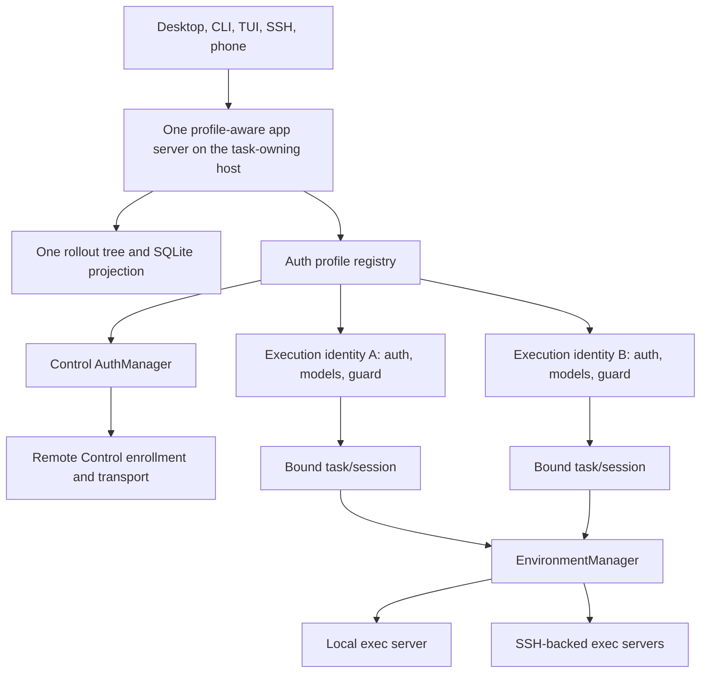

# Multi-Account Fleet Execution - Plan

## Goal Capsule

- **Objective:** Let every participating task-owning Codex host enroll multiple ChatGPT subscription accounts, route each new task to an eligible account, retain existing explicit/default local or SSH execution-environment behavior, and keep the task visible and resumable through the same per-host task store, Desktop, CLI, SSH, and Remote Control surfaces.
- **Authority:** The Product Contract owns behavior and scope. Session-settled Product and Technical Decisions override inferred assumptions. Repository guidance and current app-server v2 conventions constrain implementation details.
- **Execution profile:** Fetch the latest `openai/codex` main, branch from that exact tip, and deliver a narrow downstream patch in dependency order. Run most implementation, test, schema, documentation, and fix work on GPT-5.6 Luna at max effort. Reserve stronger or more expensive models for orchestration and the small number of auth, migration, security, integration, and release judgments that justify escalation. Reuse the existing auth storage, thread store, app-server v2, `EnvironmentManager`, and Remote Control transport before adding new machinery. Pin public release candidates to a reviewed stable upstream tag after the main-based development patch is proven.
- **Stop conditions:** Run U0 before the generalized implementation. Stop before U1 if the official phone cannot match the baseline control-account surfaces for a secondary-executed ordinary task, or if no stable provider identity claim supports durable binding. Stop public distribution if service authorization or naming is not cleared. Stop live automatic routing and reassess if a subscription is flagged, suspended, or specially throttled in response to the private proof. Do not bypass any gate with credential copying, shared SQLite, a hidden transcript, or an account-unaware runtime.
- **Tail ownership:** Completion includes migration safety, generated protocol schemas, focused and full test gates, Desktop/runtime compatibility proof, fleet smoke tests, rollback instructions, and license/notice hygiene.

---

## Product Contract

### Summary

Add N-account execution profiles to one real `CODEX_HOME` on each host, keep one distinguished control profile for Remote Control, and bind every ordinary task to a durable execution profile and workspace account.
Route new tasks across eligible accounts while preserving existing explicit/default local and SSH execution-environment selection, without splitting the host's rollout files or SQLite index.

### Problem Frame

Codex currently treats authentication as process-global even though task history, app-server state, and Remote Control already have independent lifecycles.
Using a different `CODEX_HOME` for each subscription isolates credentials, but it also fragments sessions, configuration, task indexes, and the Desktop/phone view that the user is trying to unify.

The second pain is capacity continuity: one subscription can reach a usage limit while another paid subscription remains available, forcing manual logout/login and risking account drift on existing tasks. New-task routing should use independently enrolled subscriptions without exceeding either account's service-reported limits or changing an existing task's identity.

The fleet also has two distinct host concepts.
The app-server host owns the task and its `CODEX_HOME`; an execution environment is where commands, files, skills, and MCP processes run.
The open-source runtime can route the latter through `EnvironmentManager`, including SSH-backed exec servers, but the closed Desktop client owns which app-server connection creates a task.

The product therefore needs to separate three identities explicitly: task-owning app-server host, execution environment, and execution subscription account.

### Actors

- A1. **Fleet owner:** Enrolls accounts on hosts, designates the control profile, configures project eligibility, and manages releases.
- A2. **Desktop/CLI operator:** Starts, resumes, forks, and monitors tasks from a connected host.
- A3. **Remote operator:** Uses the official phone or another signed-in controller to inspect and continue tasks through Remote Control.
- A4. **Codex task and subagents:** Use the task's persisted execution account and environment without silently changing identity.
- A5. **Fork maintainer:** Rebases the downstream patch, publishes signed binaries, verifies Desktop compatibility, and preserves licensing obligations.

### Requirements

**Account identity and enrollment**

- R1. Each host has one real `CODEX_HOME` for configuration, sessions, archived sessions, memories, packages, and the local SQLite state/index.
- R2. A host may enroll any number of named execution profiles without hard-coded emails, organizations, or host names; credentials remain isolated and host-local. Server-generated immutable opaque IDs, never labels or account strings, identify profile storage.
- R3. An existing ChatGPT OAuth root credential becomes a stable implicit legacy profile and the initial default/control profile; later role changes do not change its identity. API-key or unauthenticated roots create no implicit subscription profile: legacy continuation first requires local enrollment and explicit binding, and Remote Control requires an enrolled OAuth control profile.
- R4. Every participating app-server host can enroll the same logical subscriptions independently; no account is permanently pinned to one host.
- R5. Account management supports add, list, reauthenticate, select default execution profile, designate control profile, drain, and logout/remove while retaining immutable, non-secret historical identity tombstones. Profile IDs are never reused; duplicate enrollment of the same provider identity reuses or rejects the existing record, and reauthentication as a different identity creates a new profile.
- R6. OAuth consent, MFA, CAPTCHA, password entry, credential revocation, destructive removal, and changing the control identity remain local human-confirmed actions unavailable to Remote Control or agent tools.

**Task persistence and identity**

- R7. Routed work is always an ordinary durable Codex task in the owning host's existing rollout tree and thread store; no shadow transcript or hidden worker task is introduced.
- R8. A task persists an opaque execution-profile ID, the U0-validated non-reversible local provider-identity fingerprint, and server-validated workspace-account ID as canonical rollout metadata, with nullable SQLite projection fields for listing and recovery. New tasks write this in `SessionMeta`; a dedicated appended binding record makes the first legacy continuation durable without rewriting its original first line.
- R9. Resume uses the persisted binding. Forks and subagents inherit it unless a later explicit migration feature creates a new task.
- R10. Draining excludes a profile from new tasks but allows its existing tasks to continue. Missing, reauth-required, logged-out, tombstoned, identity-mismatched, or permanently failed credentials block outbound work with an actionable error; Codex never silently substitutes another account.
- R11. On first continuation, a legacy task with no binding uses the stable implicit OAuth profile when one exists, or requires an explicit locally enrolled subscription profile when it does not, then appends that exact binding before any outbound request; changing default/control roles cannot change later resume identity.
- R12. App-server task responses use an explicit allowlist: opaque profile ID, owner-chosen non-PII label, lifecycle/health, opaque workspace ID, owning-host ID, and environment ID. Local management may resolve richer workspace display data; Remote Control, tasks, diagnostics, rollouts, and SQLite receive no email, organization name, raw provider subject, or credential material.

**Control plane and client parity**

- R13. Remote Control enrollment, pairing, refresh, device listing, and control-plane account state always use the designated control profile.
- R14. Model requests, model availability, token refresh, thread-scoped MCP work, and OpenAI-backed extensions use the task's execution profile.
- R15. A secondary-executed task signed into the control account must match the U0 primary-task baseline on these exact official surfaces: phone host discovery, the owning host's Remote Control task list, task detail with streaming/steer/interrupt/resume, and the control-account Recent and Projects surfaces wherever the baseline ordinary Remote Control task appears. The currently connected Desktop must also list/read/resume it. Transient connection-only visibility does not pass; cross-host merged search and notifications remain deferred.
- R16. The same forked binary supplies Desktop app-server, CLI, TUI, exec, SSH-hosted app-server, daemon, and Remote Control behavior on every supported host.
- R17. The unmodified official Desktop may use the forked runtime through its external CLI path override, but v1 does not promise a native Desktop account picker or badge that the closed client does not render.

**Routing and fleet behavior**

- R18. New-task routing supports explicit profile selection, a fixed default, and deterministic least-recently-used round-robin among eligible healthy profiles; an eligible explicit selection always wins over automatic routing.
- R19. Profile-specific rate-limit snapshots may refine new-task selection only after their freshness and account ownership are proven; missing or stale usage data is lower-confidence capacity, never unlimited capacity.
- R20. The directly connected Desktop/CLI/SSH app-server host owns the task and selects an enrolled profile by server-enumerated workspace membership, lifecycle state, and observed health. It independently selects an execution environment by canonical project root and observed health; explicit inputs can choose only eligible values.
- R21. Within one owner host, duplicate enrollment of the same provider identity never creates extra scheduler candidates. Across independent owner hosts, enrollment never advertises synthetic extra quota: service-reported per-account limits remain authoritative, while fleet-wide claim coordination is deferred with the broker.
- R22. V1 does not add a second scheduler for execution environments. It preserves explicit client selection and the existing configured/default local or SSH-backed environment, persists the latest environment ID for cold resume, permits reconnect of that same ID, and forbids automatic migration to another ID. An explicit turn override may change environments without changing the account binding.
- R23. Each host can still act as an independent task-owning app server when reached directly through Desktop SSH, CLI, or Remote Control.

**Operations and productization**

- R24. Multiple processes sharing one host home coordinate profile lifecycle, cache invalidation, request leases, and scheduler selection through durable transactions or fresh reads. A completed logout/remove cannot leave another process using the removed credential, and a scheduler claim is revalidated before the first generative request.
- R25. Development branches start from freshly fetched `openai/codex` main and are pushed to the Novotny LLC fork. Private fleet candidates pin a reviewed stable upstream tag and carry a narrow patch queue, compatibility CI, generated schemas, signed artifacts, and two-slot fork rollback. Public provenance, SBOM/license bundles, and distribution metadata become mandatory only after R27 clears. Only signed profile-aware fork builds access the live home; emergency history access is an offline read-only file export for inspection, never an account-unaware Codex runtime.
- R26. The fork preserves Apache 2.0 `LICENSE` and `NOTICE` obligations, marks downstream changes, audits third-party notices, does not redistribute the closed Desktop application, and uses a neutral product name unless OpenAI trademark permission is obtained.
- R27. Public distribution is gated on a separate service-authorization review for first-party subscription OAuth; this does not block private proof or the generic local architecture.

### Key Decisions

- **One home per host** (session-settled: user-directed — chosen over separate `CODEX_HOME` values: separate homes split the SQLite/task universe the feature is meant to preserve). Governs R1, R7, R8, R11, R24.
- **Every participating host may enroll every account** (session-settled: user-directed — chosen over pinning one account to the Mac Mini or to SSH: either account must be usable from any participating machine). Governs R2, R4, R18, R23.
- **Tasks remain visible ordinary tasks** (session-settled: user-directed — chosen over off-book workers or transcript forwarding: secondary-account work must stay visible and resumable). Governs R7, R12, R15.
- **Control identity is separate from execution identity** (session-settled: user-directed — chosen over account-pinned Remote Control or SSH transports: the primary control plane must remain stable while task execution can use either subscription). Governs R13-R16.
- **Paid-account routing is a supported product behavior** (session-settled: user-directed — chosen over a blanket ban on automatic routing: separately enrolled paid accounts are not assumed to be circumvention). Governs R18-R21. Public positioning still honors each account's own limits and passes the review in R27.
- **Downstream fork first, upstreamable seams where practical** (session-settled: user-directed — chosen over depending on an upstream pull request: OpenAI does not reliably accept third-party feature PRs on the required timeline). The private fork is the delivery path; narrowly separable protocol/persistence changes may still be proposed upstream later to reduce rebase cost, but upstream acceptance never blocks this plan.

### Key Flows

- F1. **Enroll an execution profile on a host**
  - **Trigger:** A1 adds a profile through app-server or CLI.
  - **Steps:** Codex creates a server-generated, expiring, single-use enrollment attempt bound to the intended profile operation and OAuth state/device code. On completion it verifies the U0-characterized provider identity, stores credentials under the isolated auth root, derives workspaces from the service, and leaves control unchanged. Replay, expiry, cancellation, or a swapped completion fails before storage; duplicate identity enrollment reuses or rejects the existing record.
  - **Outcome:** The host reports the profile as eligible or as needing a specific follow-up action.
  - **Covered by:** R1-R6, R24.
- F2. **Start an automatically routed task**
  - **Trigger:** A2 starts a task without an explicit profile or environment.
  - **Steps:** The app server reached directly by Desktop, CLI, SSH, or Remote Control becomes the owner. It selects an eligible profile and uses the client's explicit or existing configured/default execution environment. A profile-specific model-catalog preflight may run after identity selection; Codex persists the canonical binding before the first generative turn request, then starts one ordinary task.
  - **Outcome:** One durable task appears in normal lists and all requests use its bound identity.
  - **Covered by:** R7-R10, R12, R18-R22.
- F3. **Resume, fork, or spawn a subagent**
  - **Trigger:** A2, A3, or A4 continues an existing task.
  - **Steps:** Codex reads the canonical binding, resolves the same profile, restores the sticky environment, and rejects continuation with a targeted recovery message if the profile is unavailable.
  - **Outcome:** Identity does not drift across lifecycle boundaries.
  - **Covered by:** R8-R11, R14, R22.
- F4. **Control secondary-account work from the phone**
  - **Trigger:** A3 opens the task through Remote Control signed in as the control account.
  - **Steps:** Remote Control authenticates with the control profile, lists the owning host's ordinary thread store, and relays task requests while the task's model traffic continues through its execution profile.
  - **Outcome:** The phone can discover, stream, steer, interrupt, and resume the secondary-executed task without changing enrollment.
  - **Covered by:** R13-R16.
- F5. **Drain, reauthenticate, or remove a profile**
  - **Trigger:** A1 changes profile state or authentication fails permanently.
  - **Steps:** `active -> draining` excludes new tasks while existing tasks continue. `active|draining -> reauthRequired` blocks outbound work until the same provider identity reauthenticates. Logout deletes only that profile's secrets and blocks bound tasks; tombstoning retains minimized non-secret identity metadata. Logout/removal/tombstoning of the control holder is refused until F7 succeeds; control reauth failure blocks Remote Control with local recovery guidance. Removal reports affected-task counts and requires confirmation.
  - **Outcome:** Existing task identity remains explainable and no task is silently rerouted.
  - **Covered by:** R5, R6, R9, R10, R24.
- F6. **Update or roll back the forked runtime**
  - **Trigger:** A5 refreshes the development branch from upstream main or prepares a release from a stable upstream tag.
  - **Steps:** The maintainer fetches upstream main, creates or rebases a `codex/` branch from the intended upstream commit, pushes it to `novotnyllc/codex`, regenerates schemas, and runs focused compatibility tests. A canary validates Desktop, CLI, SSH, and Remote Control; rollout advances or atomically switches the managed path to the previous signed profile-aware fork build. If both fork slots fail, stop Codex execution and export rollout/history files read-only for manual inspection.
  - **Outcome:** An upstream or Desktop incompatibility cannot strand every host.
  - **Covered by:** R16, R17, R25-R27.
- F7. **Reassign the control profile**
  - **Trigger:** A1 explicitly selects a different active ChatGPT profile as control.
  - **Steps:** Codex proves a new Remote Control enrollment first, compare-and-set updates the single control role, restarts the app-server/daemon in v1, and removes the old enrollment only after the new one is healthy. Failure rolls back the role and keeps task bindings unchanged.
  - **Outcome:** The fleet reconnects after the deliberate restart without losing enrollment or rebinding execution tasks.
  - **Covered by:** R5, R6, R13, R24.

### Acceptance Examples

- AE1. **Unified local history:** Given two enrolled profiles in one host home, when each starts a task, then `thread/list` returns both from the same store and both survive app-server restart.
- AE2. **Sticky account:** Given a task bound to profile B, when it is resumed, forked, and used to spawn a subagent, then all model requests carry profile B's account/workspace identity.
- AE3. **Lifecycle semantics:** Given profile B is drained after task creation, its existing task continues but no new task selects B. Given B becomes reauth-required or logged out, resume blocks with the exact recovery action and never uses A.
- AE4. **Primary control, secondary execution:** Given U0 records the official surfaces for a primary-executed ordinary Remote Control task, Remote Control is enrolled with A, and a task is bound to B, then the secondary task matches that baseline on host discovery, owning-host task list, task detail/control verbs, applicable control-account Recent/Projects views, and connected-Desktop list/read/resume; control traffic stays on A and model traffic on B through independent refreshes and restart.
- AE5. **Round-robin:** Given two equally weighted eligible healthy profiles, when four new tasks start, then selection alternates deterministically even across two app-server processes sharing the home.
- AE6. **Quota uncertainty:** Given one fresh healthy snapshot and one stale/failed snapshot, when automatic routing runs, then the fresh profile is preferred and the stale profile is not treated as unused capacity.
- AE7. **Owner/environment parity:** Given Desktop or CLI connects directly to H, H owns the task and must have its selected profile. An explicit or configured/default SSH environment with the canonical project root may execute tools without subscription credentials; v1 does not automatically choose among otherwise eligible environments.
- AE8. **Environment outage:** Given a selected environment disconnects before the first turn or mid-task, the task remains bound and reports a recoverable error. Automatic reconnect may restore the same environment ID; only an explicit turn override may select another ID.
- AE9. **Legacy migration:** Given a pre-feature task and the implicit legacy profile, when default/control roles change before its first upgraded resume, then the resume appends the legacy profile binding before outbound work and later SQLite rebuild/restart/reauth resolves the same identity without rewriting earlier lines.
- AE10. **Runtime rollback:** Given a Desktop/app-server protocol smoke test fails after an update, switching to the previous signed profile-aware fork restores full operation. If both slots fail, execution stays stopped and a credential-free read-only history export is available for manual inspection.
- AE11. **Atomic control reassignment:** Given active tasks and control profile A, changing control to B succeeds only after B's enrollment is healthy and a daemon restart completes; failed pairing or restart leaves A in control and never changes task bindings.
- AE12. **Cross-process invalidation:** Given processes P1 and P2 share the home, after P1 logs out or removes profile B successfully, P2 cannot issue another request with B; concurrent role and scheduler updates fail closed on stale versions.
- AE13. **No implicit OAuth profile:** Given a pre-feature task on an API-key or unauthenticated root, its first upgraded continuation stops before outbound work, requires local ChatGPT OAuth enrollment and explicit profile selection, appends that exact binding, and later restart/reindex resumes only that profile.

### Success Criteria

- The real two-account, multi-host matrix passes AE1-AE13 without copying tokens or state databases.
- Secondary-executed tasks remain visible in official phone and Desktop task views under the control account.
- Before fleet rollout, each owner host's machine-readable account-session list proves the intended logical profiles are enrolled, healthy, and correctly assigned to control/default roles; external fleet tooling may aggregate these per-host reports without receiving credentials.
- Focused Rust suites, generated schema checks, migration recovery tests, and the approved full workspace suite pass.
- A latest-main development refresh and a stable-tag release rebase can both be reproduced from the documented patch queue and rolled back on one canary host before fleet rollout.

### Scope Boundaries

**In this plan**

- Multiple execution profiles in one per-host home, task binding, account lifecycle, account-aware model and extension traffic, control/execution separation, new-task account routing, existing execution-environment parity, official-client proof, and fork operations.

**Deferred to follow-up work**

- Automatic selection of which app-server/`CODEX_HOME` owns a new task, cross-host scheduler claims, cross-host merged search/notifications, and a custom fleet broker. Stock Desktop connection selection is outside this repository. U0 still requires secondary tasks to match whatever control-account Recent/Projects surfaces an ordinary owning-host Remote Control task receives today.
- Automatic execution-environment selection beyond existing explicit/configured-default behavior.
- Native account/host pickers or badges inside the closed official Desktop UI. V1 exposes additive route metadata for clients that can render it and automatic behavior for clients that cannot.
- Mid-task account failover or migration. A future migration must create an explicit fork/new task with a new binding and audit trail.
- Public distribution and a product name until OAuth/service authorization and trademark review are complete.

**Never**

- Synchronizing access/refresh tokens between hosts, network-sharing SQLite, inventing extra quota from per-host enrollment, exposing secrets through agent APIs, silently changing an existing task's account, or hiding routed work outside the ordinary thread store.

### Dependencies and Outstanding Questions

- **Deferred external proof:** The official phone/backend may enforce task visibility using execution-account or model-provider ownership despite the local Remote Control separation. U0 resolves this before the generalized implementation; failure means the full user outcome is blocked, and any local-only subset requires an explicit reduced-scope decision rather than silently shipping as this product.
- **Deferred client capability:** The external Desktop CLI path override is observed behavior, not a documented stable API. U0 may use a manually installed owner-controlled development build; U8 formalizes a verified managed path and two-slot rollback. If the override disappears, live-home operation stops until another profile-aware launch path exists.
- **Deferred fleet coordination:** Independent owners cannot make atomic cross-host quota claims. Each host uses service-reported limits and never invents capacity from enrollment count; global coordination waits for the broker.
- **Private-proof enforcement risk:** Separately paid accounts are not presumed to violate policy, but any account flag, suspension, or routing-specific throttle during live proof stops automatic routing pending review.
- **Deferred public release:** Apache 2.0 covers the source fork, not OpenAI service authorization or trademarks. Public binaries wait for those reviews; private implementation does not.

### Sources

- `AGENTS.md` — app-server v2, schema generation, test, platform, and repository conventions.
- `codex-rs/app-server/README.md` — app-server lifecycle, stable/experimental API rules, thread environments, Remote Control, and schema generation.
- `codex-rs/app-server-protocol/src/protocol/v2/account.rs` — existing unfinished account-session types and rate-limit data.
- `codex-rs/login/src/auth/manager.rs` and `codex-rs/login/src/auth/storage.rs` — current single-manager cache and path-derived file/keyring storage.
- `codex-rs/protocol/src/protocol.rs`, `codex-rs/thread-store/src/local/`, and `codex-rs/state/` — rollout source of truth and SQLite projection.
- `codex-rs/exec-server/src/environment_toml.rs` and `codex-rs/core/src/environment_selection.rs` — existing local/SSH execution-environment registry and sticky selection.
- `codex-rs/app-server-transport/src/transport/remote_control/auth.rs` — Remote Control's explicit `AuthManager` dependency.
- [Codex App Server documentation](https://learn.chatgpt.com/docs/app-server) — current initialization, login, task, and rate-limit contracts.
- [OpenAI Codex releases](https://github.com/openai/codex/releases) — stable-tag and app-server compatibility baseline.
- [First-class multi-account request](https://github.com/openai/codex/issues/4432) and [multi-account rotation request](https://github.com/openai/codex/issues/9648) — issue evidence for the existing gap, not product contracts.
- [OpenAI Terms of Use](https://openai.com/policies/terms-of-use/), [Apache 2.0 license](https://github.com/openai/codex/blob/main/LICENSE), and [OpenAI brand guidelines](https://openai.com/brand/) — distribution and positioning constraints.

---

## Planning Contract

### Assumptions

- V1 adds no host load balancer: the directly connected app server owns the durable task, and execution uses the client's explicit or existing configured/default environment. Automatic owner/environment selection is deferred as stated in Scope Boundaries.
- Automatic routing plus CLI/TUI management is sufficient for v1 even though the unmodified Desktop cannot render a native picker or badge.
- A ChatGPT OAuth root credential becomes the initial control/default profile; API-key and unauthenticated roots require explicit subscription enrollment before binding.
- Public release preparation is in scope, but public distribution is not a completion requirement until external authorization and naming gates pass.
- Explicit selection and deterministic round-robin ship before adaptive quota-based routing; quota data earns influence only through tests.

### Key Technical Decisions

- KTD1. **Separate auth storage root from data home.** Add an `AuthManager` constructor that accepts an explicit auth storage root while configuration, rollouts, memories, packages, and SQLite continue to use the real home. Additional profiles live under `CODEX_HOME/auth/profiles/<validated-opaque-id>`; IDs are server-generated single path components, containment is verified, symlink roots are rejected, and labels/account IDs never become paths. Version a collision-resistant keyring namespace from canonical base home plus stable profile ID while preserving the legacy root namespace.
- KTD2. **Bootstrap one control manager and a registry of execution identities.** Construct `AuthProfileRegistry` in app-server bootstrap (`lib.rs` and `in_process.rs`) before Remote Control, then pass the same distinguished control manager to Remote Control and the execution resolver to `MessageProcessor`. Each execution identity is a matched `{AuthManager, SharedModelsManager, ProfileRequestGuard}` triple; the guard owns request leases and final lifecycle/fingerprint validation. V1 control-role reassignment uses explicit app-server/daemon restart rather than hot-swapping a live handle.
- KTD3. **Make rollout metadata canonical.** U0 first characterizes a stable provider subject and derives a non-reversible host-local fingerprint; raw account claims and display PII never enter rollouts. Add profile/workspace/fingerprint fields to new-task `SessionMeta` and an appended `SessionIdentityBinding` item for first legacy continuation; extraction resolves the immutable binding without modifying earlier lines. Project it into nullable `threads` columns. SQLite owns mutable minimized profiles/tombstones, lifecycle, eligibility, and scheduling timestamps but never tokens; rebuild verifies the live fingerprint before resume.
- KTD4. **Select execution identity at thread boundaries.** `thread/start` selects or accepts an eligible profile before persistence. Cold resume resolves the saved `{AuthManager, SharedModelsManager, ProfileRequestGuard}` triple. Fork and subagent paths inherit it through `Session`, `TurnContext`, model managers, MCP, and `ExtensionDataInit`. Namespace model caches by profile, and never let a backend client opportunistically switch accounts.
- KTD5. **Reuse app-server v2 account-session types.** Register and implement the existing `AccountSessions*` protocol types as experimental methods, extending them only for stable profile identity, control/default roles, lifecycle state, and per-profile health. Preserve current single-account methods for legacy clients.
- KTD6. **Audit account-aware consumers by role without cloning global registries.** Model clients, refresh state, thread-scoped MCP, and auth-capturing web-search/image-generation/git-attribution extensions resolve thread auth. Keep the process extension registry and inject thread auth through `ExtensionDataInit`; do not build a full registry per profile. Additional profiles cannot inherit process-global API/PAT credentials unless explicitly profile-scoped. Each profile owns refresh locks, failure state, watchers, and external auth; pairing and Remote Control use control auth.
- KTD7. **Use an atomic host-local last-use claim for the first scheduler.** Equal-priority profiles select the eligible row with oldest committed `last_used_at` using lifecycle/version predicates in one SQLite transaction. Revalidate before the first generative request and never substitute. A crash may consume a fairness slot; do not race by rolling it back. An eligible explicit binding wins. Service-reported per-account limits are the only cross-host capacity signal; local fairness never implies remaining quota.
- KTD8. **Reuse execution environments without a new scheduler.** Persist and restore the latest selected `TurnContextItem.environments`; configured defaults alone are not restart stickiness. Reuse `EnvironmentManager`, explicit/configured-default selection, and SSH exec-server transports; allow same-ID reconnect and explicit turn overrides. Do not add automatic environment or task-owner selection in v1.
- KTD9. **Gate generalized work on U0.** Before U1, a disposable dual-identity spike must characterize provider identity and compare a primary-executed baseline with control-account Remote Control plus secondary-account model execution on every R15 surface. Local mock success is necessary but not sufficient; a failed full-outcome gate requires a new user scope decision.
- KTD10. **Treat Desktop override as a verified compatibility adapter.** Install a signed launcher at an OS-managed owner-only path outside `CODEX_HOME`; Desktop `CODEX_CLI_PATH` and the downstream daemon both use it. The launcher verifies ownership/mode and signatures against an independently pinned OS/release trust root, then atomically selects current/previous profile-aware slots. Patch the daemon's existing `CODEX_HOME/packages/standalone/current/codex` assumption, and disable/replace upstream bootstrap/update behavior that could overwrite the fork. Only verified slots access the live home; emergency history export is inspected without an account-unaware runtime.
- KTD11. **Keep the downstream patch narrow.** Develop from a freshly fetched upstream main on `codex/` branches pushed to `novotnyllc/codex`; cut releases from reviewed stable tags. Isolate feature code in small modules, regenerate app-server/config schemas, avoid rebranding upstream source packages initially, and carry Apache/NOTICE changes in distribution artifacts rather than modifying closed Desktop assets.
- KTD12. **Make lifecycle and roles explicit.** Lifecycle is `active`, `draining`, `reauthRequired`, `loggedOut`, or `tombstoned`; control/default are orthogonal roles with exactly one valid holder when any OAuth profile exists. Local compare-and-set mutations publish cross-process invalidation before success. Reauthentication preserves an ID only when identity matches; removal reports affected tasks and keeps a never-reused minimized tombstone. The control holder cannot log out, be removed, or be tombstoned until reassignment; control reauth failure blocks Remote Control rather than failing over.
- KTD13. **Derive eligibility server-side.** Workspace IDs come from memberships enumerated by the authenticated profile, and configured project roots are canonicalized in the selected execution environment. Explicit choices win only inside that eligible set; lost membership, symlink escape, or identity mismatch fails closed with recovery guidance.
- KTD14. **Enforce local-human management at transport ingress.** Derive an unforgeable management capability from app-server `ConnectionState`/`ConnectionOrigin`, never JSON-RPC params, and propagate it through `MessageProcessor` into every request context. Direct local interactive CLI/in-process management with one-shot human confirmation may mutate accounts; Remote Control relays, task/agent/MCP/extension calls, unauthenticated local sockets, and unknown origins deny by default. Legacy endpoints obey the same matrix.
- KTD15. **Bind login completions to one attempt.** Enrollment/reauth creates an expiring single-use attempt tied to the intended operation, target profile, and OAuth state/device-code context. Replay, cancellation, expiry, concurrent swap, or different provider identity fails before credentials are stored.
- KTD16. **Serialize destructive lifecycle changes with outbound use.** `ProfileRequestGuard` uses the repository's existing file-lock primitive where possible to acquire a per-profile cross-process lease. Every model, MCP, and auth-capturing extension send holds a shared lease through final lifecycle/fingerprint validation and credential use. Logout/removal obtains the exclusive lease, cancels/drains earlier sends, commits state, invalidates caches, and deletes/revokes secrets before returning; if bounded drain cannot complete, the mutation fails without reporting success.
- KTD17. **Fail closed when mutable profile state is unavailable.** If SQLite/profile registry startup fails, automatic routing and management are disabled. Only unbound legacy tasks backed by a valid implicit OAuth profile may continue; any profile-bound start/resume returns state-recovery guidance. No path silently falls back to root auth.
- KTD18. **Default implementation to Luna Max.** (session-settled: user-directed — chosen over frontier-model implementation by default: GPT-5.6 Luna at max effort is inexpensive enough to use for most code while preserving stronger models for the few judgments that need them.) Every coding lane starts on `gpt-5.6-luna` at `max`. Escalation changes the model only for a bounded question or review, not for the entire lane.

### High-Level Technical Design

Task routing is a one-time decision at creation:

1. Resolve an eligible explicit profile, if present, and preserve the client's explicit or existing configured/default environment behavior.
2. Filter host-enrolled profiles by server-enumerated workspace membership, lifecycle version, project policy, and observed health.
3. Choose the eligible default or least-recently-used profile; never infer capacity from other-host enrollment.
4. Commit the scheduler claim, allow profile-specific model-catalog preflight, persist the canonical account binding before the first generative request, then update its SQLite projection; a failed persistence may waste a fairness slot but never creates an unbound task.
5. Construct the session with the chosen `{AuthManager, SharedModelsManager, ProfileRequestGuard}`, thread auth extension context, and sticky environment.
6. Resume, fork, and subagent paths read or inherit those bindings; they do not run the scheduler again.

### System-Wide Impact

- **Authentication:** Storage identity, minimized provider fingerprint, refresh serialization, request origin/capability, login-attempt state, cross-process request leases, logout semantics, model catalogs/caches, extensions, MCP, external auth, analytics attribution, and account notifications must be classified as control-scoped or task-scoped.
- **Persistence:** Rollout serialization, state migrations, index extraction, thread summary/list/read, legacy recovery, archive/unarchive, fork, and paginated-history materialization gain nullable binding fields.
- **Concurrency:** Multiple app-server/CLI processes can share a home. Profile lifecycle, role compare-and-set, and `last_used_at` selection require transactions; in-memory caches must invalidate before mutations report success.
- **Clients:** Additive experimental v2 fields must not break legacy Desktop clients. CLI/TUI/custom clients render only the R12 allowlist; official Desktop compatibility is black-box tested against the U0 baseline.
- **Remote Control:** Transport startup, enrollment refresh, daemon restart, and SSH restart use the control identity while remote JSON-RPC accesses the ordinary task store. Control reassignment proves the replacement enrollment before an explicit restart.
- **Fleet:** Execution environments remain distinct from task-owning app-server hosts. Remote file/command paths, project roots, permissions, skills, and MCP execution follow the selected environment.
- **Operations:** Upstream standalone-daemon installers can replace a downstream binary. The fork needs a stable install path and must not rely on the upstream hourly bootstrap for its runtime.

### Risks and Mitigations

| Risk | Consequence | Mitigation / gate |
|---|---|---|
| Official backend binds mobile visibility to execution account | Secondary tasks disappear or cannot resume on the phone | U0 real-account gate before generalized work; full outcome stops pending an explicit reduced-scope decision |
| A process-global auth consumer is missed | Model discovery, MCP, extension, or refresh uses the wrong subscription | U4 auth-consumer inventory plus concurrent bearer/workspace assertions |
| Refresh/logout on one profile invalidates another | Active tasks fail across accounts | Isolated auth roots, per-profile refresh locks, no shared token copying, and dual-profile recovery tests |
| Client input escapes auth/project roots or selects an unauthorized workspace | Credential exposure or execution outside policy | Opaque ID containment/symlink rejection, canonical project roots, server-derived memberships, and adversarial path tests |
| SQLite migration and rollout metadata disagree or a tombstoned ID is reused | Tasks list or resume with the wrong binding | Rollout fingerprint remains canonical; IDs are never reused; extraction/reindex and delete/re-add tests fail closed |
| Two processes select the same profile repeatedly | Round-robin collapses under concurrency | Transactional selection and `last_used_at` update with multi-process tests |
| Stale quota looks like free capacity | Scheduler overloads an exhausted account | Unknown/stale health is penalized; explicit policy and deterministic fallback |
| Stale process cache uses a logged-out profile | Removed credentials remain active after management returns | Versioned lifecycle transactions, cross-process invalidation acknowledgement, and revalidation before first request |
| Desktop/runtime protocol drift | White screen, startup failure, or missing task fields | Stable tag, generated schema diff, target-Desktop smoke matrix, canary, and previous signed-fork rollback |
| Account-unaware bundled runtime opens the live home | Historical work silently runs as the root account or mutates state | Never allow it on live home or recovery exports; use only the previous fork for runtime rollback and manual tools for credential-free history exports |
| Fork path is tampered with or world-writable | Arbitrary binary can read all host-local profile tokens | Absolute owner-controlled path plus signature/hash/provenance verification before launch |
| Upstream daemon replaces the fork | Hosts silently lose multi-account support | Fork-owned stable path and installer/update channel; disable upstream runtime replacement for forked hosts |
| Control reassignment fails halfway | Phone loses the fleet or two profiles appear authoritative | Prove replacement enrollment, compare-and-set one role, restart, then retire old enrollment; rollback on failure |
| Secret data leaks through new metadata or children | Tokens enter rollouts, SQLite, logs, SSH/MCP environments, or artifacts | Opaque approved metadata only, restrictive permissions, canary-token scan across success/failure paths |
| Remote or agent caller reaches account management | Prompt injection or remote control can log out accounts or reassign control | Server-created local-management capability at transport ingress; default-deny tests for every management method |
| Login callback is replayed or swapped | Credentials bind to the wrong profile | Expiring single-use attempt bound to operation, target, and OAuth/device context |
| Logout races a cached outbound request | Another process uses a credential after logout returns | Per-profile cross-process shared/exclusive request lease plus final revalidation |
| Profile state database is unavailable | Bound work silently falls back to root auth | Disable routing/management and reject bound work with recovery guidance |
| Public fork implies OpenAI endorsement or service authorization | Trademark or account-access dispute | Neutral name, Apache/NOTICE compliance, no closed assets, and pre-distribution legal/service review |

### Sequencing

U0 first characterizes provider identity and proves the official-client outcome with the smallest disposable vertical slice.
Only after U0 passes do U1 and U2 establish generalized profile storage and management.
U3 persists task identity, then U4 closes execution-auth parity gaps.
U5 hardens control identity and repeats the complete phone/control-reassignment matrix.
Only after U5 passes does U6 add automatic account routing; U7 proves existing explicit/default local/SSH environment parity without another scheduler.
U8 packages the proven behavior with compatibility and rollback controls.

### Delivery Orchestration and Model Routing

Use a Delivery Director to coordinate independently resumable Goal-Driven Delivery lanes. Keep one canonical writer per unit and run the smallest applicable verification before integration.

| Work | Default model and effort | Escalation rule |
|---|---|---|
| U0-U8 implementation, focused tests, generated schemas, documentation, and review fixes | `gpt-5.6-luna`, `max` | Default for all coding; do not escalate merely because the unit is large |
| Mechanical inventory, formatting, and schema regeneration | `gpt-5.6-luna`, `high` or `max` | Use `max` when the edit crosses contracts or generated artifacts |
| Delivery direction, dependency arbitration, and integration synthesis | `gpt-5.6-sol`, `high` | Keep the director read-only; use `max` only for a genuine architectural conflict |
| Auth, migration, security, cross-process, and release-critical adversarial review | `gpt-5.6-sol`, `max` | Review a bounded diff or decision after Luna Max completes the implementation |
| Coherence, scope, documentation review, and independent secondary review | `gpt-5.6-terra`, `medium` or `high` | Prefer the lower effort that can verify the stated acceptance boundary |

Start with three parallel Luna Max workers where dependencies permit and keep one slot available for direction, review, or integration. A lane escalates only after it returns concrete evidence of an unresolved cross-cutting decision, repeats the same failed approach, or reaches a security/release gate named above.

### Execution Time Budget

- **Target:** Complete the implementation swarm and focused local verification in 60-120 minutes of active Codex execution on a capable host.
- **First 10 minutes:** Refresh the upstream baseline, map unit ownership, run U0's cheapest falsification checks, and dispatch the first Luna Max lanes.
- **Next 70 minutes:** Implement dependency-ready units, integrate continuously, and run focused crate tests rather than waiting for one monolithic tail.
- **Final 40 minutes:** Resolve review findings, run the broadest affordable local gates, commit the explicit plan-owned paths, and push the fork branch.
- **Overrun rule:** At 120 minutes, return the exact completed units, failing command or external gate, and next executable action. Do not replace an evidence-based overrun report with a multi-week estimate.
- **Excluded waiting:** Human OAuth/MFA/CAPTCHA steps, official-phone interaction, hosted CI queues, full-workspace build duration, signing service latency, and fleet canary observation are elapsed external waits. They remain Definition-of-Done gates but are not counted as coding time.

---

## Implementation Units

### U0. Provider-identity characterization and official-client vertical proof

- **Goal:** Falsify the two load-bearing external identity and official-client visibility assumptions, and characterize per-account usage telemetry before generalized storage, lifecycle, scheduler, and packaging work.
- **Requirements:** R3, R8, R13-R17, R19.
- **Dependencies:** None.
- **Files:** Narrow spike changes in `codex-rs/app-server/src/lib.rs`, `codex-rs/app-server/src/in_process.rs`, `codex-rs/app-server/src/message_processor.rs`, `codex-rs/core/src/thread_manager.rs`, `codex-rs/protocol/src/protocol.rs`, and existing Remote Control auth/tests; a checked-in proof note under `docs/` records only redacted observations, not tokens or raw provider subjects.
- **Approach:** First record the exact official-phone/Desktop surfaces for an ordinary primary-executed Remote Control task. In an isolated canary home and non-release development build, construct one primary control manager and one secondary execution identity, persist one ordinary task with a temporary opaque binding, and compare every R15 surface. Separately observe candidate provider subject/workspace claims across both subscriptions, two hosts, refresh, reauth, and workspace selection; choose a stable claim and derive a non-reversible host-local fingerprint. Also characterize each subscription's service-reported rate-limit snapshots: record used percent and reset time for every reported window, prove attribution to the credential/provider fingerprint and workspace that produced it, and establish freshness from a service timestamp when available or local receipt time otherwise. Record absent, stale, and failed responses as unknown rather than unused capacity; this spike supplies evidence only, while persistence and routing behavior remain in U6. Keep only implementation that directly becomes U1-U5; drop spike-only code before U1 review.
- **Test scenarios:** Primary baseline before/after phone connection; secondary task before/after connection; host discovery, owning-host list, task detail/control verbs, control-account Recent/Projects parity, connected-Desktop list/read/resume, restart, independent refresh, two hosts, two subjects, reauth, workspace changes, an intentionally mismatched identity, alternating requests under both accounts with distinguishable snapshots, every reported usage window, reset rollover, missing timestamps, stale/absent/failed snapshots, and workspace switching.
- **Verification:** The real two-account canary proves identity uniqueness/stability, rate-limit field semantics and per-account attribution/freshness, and complete baseline parity with redacted evidence. If identity or visibility fails, stop before U1 and present a reduced-scope or upstream-dependency decision; unavailable telemetry remains unknown and cannot be treated as unused capacity.

### U1. Profile registry and isolated credential storage

- **Goal:** Represent multiple host-local auth profiles without creating multiple data homes or credential backends.
- **Requirements:** R1-R5, R11, R24.
- **Dependencies:** U0 gate passed.
- **Files:** `codex-rs/login/src/auth/manager.rs`, `codex-rs/login/src/auth/storage.rs`, `codex-rs/login/src/auth/storage_tests.rs`, `codex-rs/state/migrations/0047_account_profiles_and_thread_binding.sql` (or next free number at implementation time), `codex-rs/state/src/runtime/account_profiles.rs`, `codex-rs/state/src/runtime.rs`, `codex-rs/app-server/src/auth_profile_registry.rs`, `codex-rs/app-server/src/lib.rs`, `codex-rs/app-server/src/in_process.rs`.
- **Approach:** Preserve a ChatGPT OAuth root credential and keyring namespace as one implicit profile; API-key/absent roots create none. Add a storage-root-aware manager and bootstrap a registry backed by minimized SQLite records. Server-generated opaque IDs select contained, non-symlinked auth roots and versioned collision-resistant keyring namespaces. The migration adds both profile tables and nullable thread-binding columns. Implement KTD12 lifecycle/roles, U0-derived local fingerprints, per-profile refresh/external-auth state, never-reused tombstones, invalidation versions, KTD16 leases, and KTD17 database-unavailable behavior.
- **Test scenarios:** Two profiles save/load/delete independently in file, direct-keyring, secrets-keyring, auto, and ephemeral modes; labels never affect paths; traversal, separators, dot segments, Unicode confusables, NUL, symlink roots, and unregistered IDs fail across every backend; key identities remain distinct/stable across restart and migration; logout cannot cross-delete; concurrent registry readers observe lifecycle/lease changes; OAuth, API-key, and absent legacy roots behave as specified; missing/corrupt SQLite disables bound work without root fallback.
- **Verification:** Focused login/state suites prove isolation, restrictive permissions, forward/backward migration, and reindex/rollback behavior; filesystem/keyring inspection contains no cross-profile token reuse or orphaning.

### U2. Account-session protocol and human management surfaces

- **Goal:** Let app-server and CLI users enroll, inspect, reauthenticate, drain, and remove arbitrary profiles on each host.
- **Requirements:** R2-R6, R12, R16, R27.
- **Dependencies:** U1.
- **Files:** `codex-rs/app-server-protocol/src/protocol/v2/account.rs`, `codex-rs/app-server-protocol/src/protocol/common.rs`, `codex-rs/app-server/src/lib.rs`, `codex-rs/app-server/src/transport.rs`, `codex-rs/app-server/src/message_processor.rs`, `codex-rs/app-server/src/outgoing_message.rs`, `codex-rs/app-server/src/request_processors/account_processor.rs`, `codex-rs/app-server/src/request_processors.rs`, `codex-rs/app-server-transport/src/transport/mod.rs`, `codex-rs/cli/src/main.rs`, `codex-rs/login/src/lib.rs`, `codex-rs/app-server/README.md`, `codex-rs/app-server/tests/suite/v2/account.rs`, generated app-server schema fixtures.
- **Approach:** Register experimental v2 account-session methods using existing types. A server-created request context enforces KTD14 before handlers run, including legacy endpoints. KTD15 binds browser/device-code completion to one expiring attempt and target operation. Return only the R12 allowlist. CLI commands use the same semantics. Destructive actions report affected-task counts; control/default compare-and-set, logout, removal, and OAuth remain local human actions.
- **Test scenarios:** Add two and three-plus profiles; replay/expire/cancel/swap concurrent login completions; reject/reuse duplicate identity; return a machine-readable non-secret readiness list; refresh server-enumerated workspaces; reject arbitrary/stale IDs; reauthenticate only as the same identity; drain without blocking existing tasks; block logout/removal/tombstone of current control until reassignment; return recovery guidance when control requires reauth; reject Remote Control, task, extension, MCP, agent, spoofed-origin, stale-role, and concurrent-role mutations; confirm affected-task counts; preserve restricted legacy endpoints.
- **Verification:** Protocol serialization, generated TypeScript/JSON schemas, app-server integration tests, and a manual device-code enrollment on a clean host all agree.

### U3. Canonical task binding and lifecycle inheritance

- **Goal:** Persist the execution profile/workspace on every task and preserve it across restart, resume, fork, and subagents.
- **Requirements:** R7-R12, R23.
- **Dependencies:** U1, U2.
- **Files:** `codex-rs/state/migrations/0047_account_profiles_and_thread_binding.sql` (or next free number at implementation time), `codex-rs/protocol/src/protocol.rs`, `codex-rs/state/src/model/thread_metadata.rs`, `codex-rs/state/src/extract.rs`, `codex-rs/state/src/runtime/threads.rs`, `codex-rs/thread-store/src/local/`, `codex-rs/core/src/thread_manager.rs`, `codex-rs/core/src/codex_delegate.rs`, `codex-rs/core/src/agent/control/`, `codex-rs/app-server-protocol/src/protocol/v2/thread.rs`, `codex-rs/app-server-protocol/src/protocol/v2/thread_data.rs`, `codex-rs/app-server/src/request_processors/thread_processor.rs`.
- **Approach:** Extend `SessionMeta`/`ThreadMetadata` for new tasks and add `SessionIdentityBinding` for first legacy continuation. A selected profile may perform model-catalog preflight before rollout creation; write canonical binding before the first generative turn request. Legacy continuation writes its binding before any outbound request because the rollout already exists. Projection may follow. Cold resume verifies the local fingerprint; fork/subagent construction passes the source execution identity.
- **Test scenarios:** Restart/cold resume, archive/unarchive, paginated/legacy history, fork boundaries, nested subagents, changed default/control roles before OAuth-legacy resume, API-key/unauthenticated legacy enrollment plus explicit binding, crash before binding, crash after binding but before projection, deleted/re-added identities, never-reused tombstones, SQLite corruption/reindex from rollout, reauth, rollback/re-upgrade, and old rollouts lacking fields.
- **Verification:** State extraction and app-server `thread/start`, `thread/list`, `thread/read`, `thread/resume`, and `thread/fork` tests return one consistent binding.

### U4. Execution-auth parity across model and extension consumers

- **Goal:** Ensure every task-scoped OpenAI request uses the bound execution profile while control-plane services remain on control auth.
- **Requirements:** R9, R10, R13, R14, R16.
- **Dependencies:** U3.
- **Files:** `codex-rs/app-server/src/message_processor.rs`, `codex-rs/app-server/src/extensions.rs`, `codex-rs/app-server/src/request_processors/thread_processor.rs`, `codex-rs/app-server/src/request_processors/turn_processor.rs`, `codex-rs/core/src/thread_manager.rs`, `codex-rs/core/src/session/session.rs`, `codex-rs/core/src/session/turn_context.rs`, `codex-rs/core/src/session/`, `codex-rs/models-manager/src/manager.rs`, `codex-rs/model-provider/src/`, `codex-rs/codex-mcp/src/runtime.rs`, `codex-rs/ext/web-search/src/extension.rs`, `codex-rs/ext/image-generation/src/extension.rs`, `codex-rs/ext/git-attribution/src/lib.rs`.
- **Approach:** Inventory every `Arc<AuthManager>` consumer and classify it by KTD6. Carry the complete execution identity, including its `ProfileRequestGuard`, through start/resume/fork/subagent, `Session`, `TurnContext`, model, MCP, and extension paths; namespace `models_cache.json` by profile. Every task-scoped send uses the guard for the KTD16 lease and final validation. Keep control analytics/config explicit; never forward profile tokens through SSH, MCP, exec-child environments, unscoped global API/PAT auth, or metadata outside R12.
- **Test scenarios:** Two concurrent mock accounts return different model catalogs and bearer/workspace headers; generation, refresh, MCP, web search, image generation, and git attribution stay on the task profile; interleaved reload/permanent-refresh-failure/reauth/logout leaves the sibling unaffected; process B cannot send after process A's logout returns; child environments and metadata contain no credentials or display PII.
- **Verification:** Concurrent mock-server assertions cover every classified task-scoped outbound client and fail on a control bearer leak.

### U5. Control-identity separation and official phone proof

- **Goal:** Keep Remote Control on the primary/control profile while secondary-bound tasks remain ordinary controllable tasks.
- **Requirements:** R13-R17, R23.
- **Dependencies:** U4; U0 external gate already passed.
- **Files:** `codex-rs/app-server/src/lib.rs`, `codex-rs/app-server/src/in_process.rs`, `codex-rs/app-server/src/message_processor.rs`, `codex-rs/app-server-transport/src/transport/remote_control/auth.rs`, `codex-rs/app-server-transport/src/transport/remote_control/`, `codex-rs/app-server/tests/suite/v2/remote_control.rs`, `codex-rs/app-server-transport/src/transport/remote_control/tests/`; modify `codex-rs/app-server-daemon/src/` only if testing proves the existing restart contract insufficient.
- **Approach:** Bootstrap one control manager before Remote Control and pass execution resolution to `MessageProcessor`. Relay JSON-RPC with server-created request origin/capability to the unified task store; task internals resolve execution identity. Implement F7 by establishing replacement enrollment, atomically switching the role, then using the existing daemon restart contract. Repeat U0's complete baseline matrix on the generalized implementation before scheduler work.
- **Test scenarios:** Remote Control headers use A while task model headers use B; tasks created before/after connection match U0 on phone host discovery, owning-host task list, applicable control-account Recent/Projects views, task detail/control verbs, and connected-Desktop list/read/resume through reconnect, app/daemon restart, and independent refresh; failed pairing/restart keeps A; former-control removal is safe; Desktop local and Desktop SSH modes preserve enrollment.
- **Verification:** AE4 and AE11 pass on the real fleet with redacted request/account evidence. If official mobile visibility fails, stop U6-U8 implementation and record whether OpenAI support or a companion client is required.

### U6. Account eligibility and new-task scheduler

- **Goal:** Route each new task to an explicitly selected or automatically eligible execution profile without mid-task identity changes.
- **Requirements:** R18-R21, R24.
- **Dependencies:** U5 gate passed.
- **Files:** `codex-rs/app-server/src/auth_profile_registry.rs`, `codex-rs/app-server/src/request_processors/account_processor.rs`, `codex-rs/app-server/src/request_processors/thread_processor.rs`, `codex-rs/state/src/runtime/account_profiles.rs`, `codex-rs/app-server-protocol/src/protocol/v2/account.rs`, `codex-rs/app-server-protocol/src/protocol/v2/thread.rs`, `codex-rs/app-server/tests/suite/v2/account.rs`, `codex-rs/app-server/tests/suite/v2/thread_start.rs`.
- **Approach:** Add server-derived workspace eligibility, canonical project policy, lifecycle/version, and health to profile records. Resolve an eligible explicit profile first, otherwise fixed default or atomically claim oldest `last_used_at`. Only fresh profile-owned service snapshots exclude/deprioritize exhausted profiles; host-local `last_used_at` never represents cross-host quota. Revalidate before the first generative request; persistence failure may leave a fairness-only bump but never an unbound task.
- **Test scenarios:** Two- and three-plus-profile host-local round-robin/fairness, explicit eligible/ineligible override, project-root symlink escape, arbitrary/stale/lost workspace membership, draining and concurrent remove/policy mutation, stale/exhausted quota/reset, duplicate identity on one host, same identity on independent hosts using the same service-reported limit but independent fairness, multi-process contention, and crashes around binding/projection.
- **Verification:** Deterministic unit tests and multi-process app-server tests prove no silent substitution and stable selection order.

### U7. Existing execution-environment and fleet parity

- **Goal:** Prove account selection works with existing explicit/configured-default local and SSH execution environments while retaining one owning task store.
- **Requirements:** R4, R7, R12, R16, R20-R23.
- **Dependencies:** U6.
- **Files:** `codex-rs/exec-server/src/environment_toml.rs`, `codex-rs/exec-server/src/environment.rs`, `codex-rs/core/src/environment_selection.rs`, `codex-rs/core/src/thread_manager.rs`, `codex-rs/app-server-protocol/src/protocol/v2/thread.rs`, `codex-rs/app-server/src/request_processors/thread_processor.rs`, `codex-rs/app-server/src/request_processors/turn_processor.rs`, `codex-rs/app-server/tests/suite/v2/turn_start.rs`, `codex-rs/exec-server/tests/`.
- **Approach:** A direct Desktop/CLI/SSH connection identifies the owner, which must enroll the chosen profile. Reuse existing explicit/configured-default selection and SSH `program` transports for tools. Persist/restore the latest environment ID, reconnect only that ID automatically, permit explicit turn override, report owner/environment separately, and add neither an environment scheduler nor federation.
- **Test scenarios:** Local and heterogeneous SSH defaults, owner missing a logical profile, execution host with no subscription credential, missing/symlinked project roots, Windows/POSIX paths, explicit start/turn override, disconnect before first turn and mid-turn, missing config on restart, same-ID reconnect, restart/resume, and subagent inheritance.
- **Verification:** Desktop-connected, CLI, direct SSH, and Remote Control tasks operate on the selected host while `thread/list` on the owning app server shows one durable task.

### U8. Fork release, Desktop adapter, and rollback

- **Goal:** Make the downstream patch maintainable and safely installable across the fleet without redistributing closed OpenAI assets.
- **Requirements:** R16, R17, R25-R27.
- **Dependencies:** U5 gate passed; U6 and U7 for full feature release.
- **Files:** `LICENSE`, `NOTICE`, `codex-rs/app-server/README.md`, `codex-rs/app-server-daemon/README.md`, `codex-rs/app-server-daemon/src/`, `codex-rs/cli/src/remote_control_cmd.rs`, packaging/release configuration already used by the repository, `.github/workflows/` compatibility jobs, downstream install/rollback documentation under `docs/`.
- **Approach:** Keep `origin` at `openai/codex`, `novotny` at `novotnyllc/codex`, and branch from fetched `origin/main`. Maintain a short patch queue and cut private candidates from reviewed stable tags. Install one signed verifier/launcher at an OS-managed path outside `CODEX_HOME`; Desktop and daemon both call it. The launcher validates current/previous slots against a pinned trust root and switches slots atomically. Patch the daemon's hard-coded standalone-package path and top-level Remote Control/bootstrap flow so no upstream updater or `CODEX_HOME/packages/standalone/current/codex` binary bypasses/replaces the launcher. Release keys are hardware/KMS-backed and restricted to approved release jobs. If both slots fail, stop execution and export credential-free history read-only. Generate public provenance/SBOM/license bundles only after R27 clears.
- **Test scenarios:** Stable-tag rebase, schema diff, signed provenance, reject relative/tampered/world-writable overrides and config-supplied trust-root changes, non-release workflows cannot sign, key rotation/revocation drill, atomic current/previous switch, Desktop and daemon resolve the same binary, upstream bootstrap/update is disabled, install on each host class, Desktop launch/task/resume, CLI/TUI/exec, SSH app-server, daemon Remote Control, canary upgrade, previous-fork rollback, forward/backward SQLite compatibility, and credential-free history export with no Codex runtime launch.
- **Verification:** The compatibility matrix, trust-root tests, two-slot rollback, and recovery export pass on a canary before fleet rollout; any public distribution contains required provenance/license/notice/change disclosures and no closed Desktop files.

---

## Verification Contract

### Automated Gates

| Gate | Command | Applies to | Required outcome |
|---|---|---|---|
| Formatting | `cargo fmt -- --config imports_granularity=Item` from `codex-rs` | All Rust units | No formatting diff |
| Login/auth | `just test -p codex-login` | U1, U2, U4 | All auth storage and refresh tests pass |
| State/migration | `just test -p codex-state` | U1, U3, U6 | Migration, extraction, reindex, and transaction tests pass |
| Core lifecycle | `just test -p codex-core` | U3, U4, U7 | Resume, fork, subagent, and environment inheritance pass |
| Protocol | `just test -p codex-app-server-protocol` | U2, U3, U6, U7 | v2 serialization and experimental gating pass |
| App server | `just test -p codex-app-server` | U2-U7 | Public JSON-RPC flows pass through `TestAppServer` |
| Client modes | `just test -p codex-tui` and `just test -p codex-exec` | U2, U3, U7 | CLI-backed modes preserve bindings |
| Execution environments | `just test -p codex-exec-server` | U7 | Local/SSH transport and health tests pass |
| Thread store | `just test -p codex-thread-store` | U3, U7 | Rollout discovery, extraction, and persistence paths pass |
| CLI | `just test -p codex-cli` | U2, U8 | Management and Remote Control command paths pass |
| Stable schemas | `just write-app-server-schema` | Protocol changes | Checked-in stable schemas match generated output |
| Experimental schemas | `just write-app-server-schema --experimental` | Experimental account/thread/environment fields | Checked-in experimental schemas match generated output |
| Config schema | `just write-config-schema` | Only if `config.toml` gains routing fields | Checked-in schema matches generated output |
| Workspace regression | `just test` | Final candidate | Full suite passes after the implementer obtains the repository-required approval |

### Behavioral Proof Gates

- **Dual-auth header proof:** Concurrent fake backends assert that control and execution requests never cross identities, model caches, refresh state, workspace headers, or logout effects.
- **Persistence proof:** Kill at each binding/projection boundary, restart app-server, rebuild SQLite from rollouts, change default/control roles, and re-run AE1-AE3, AE9, AE12, and AE13.
- **Official-client proof:** On the real fleet, run the complete AE4 surface matrix and AE11 from the official phone and Desktop local/SSH connections using the forked binary. Local mocks or transient connection visibility do not satisfy this gate.
- **Fleet proof:** Run AE7-AE8 on at least one local, one macOS SSH, and one other supported host class used by the fleet.
- **Release proof:** Install a signed canary, update once, rebase once, switch back to the previous signed fork, and complete AE10 before wider rollout.
- **Security proof:** Give each profile a unique canary token and display-PII canary, exercise success and failure paths, and scan logs, traces, errors, JSON-RPC, task metadata, rollouts, SQLite, crash output, process/SSH/MCP/exec-child environments, recovery exports, and artifacts. Any credential material, unapproved email/organization/raw subject, or field outside the R12 allowlist blocks release.
- **Distribution proof:** Before public artifacts, record service/OAuth authorization, neutral-name/trademark/non-endorsement review, Apache/NOTICE/change disclosures, third-party notices, and binary/site metadata inspection; private proof may proceed without publishing.

### Requirement Trace

| Requirements | Primary proof |
|---|---|
| R1-R6 | U0 identity gate, U1-U2 focused suites, and human enrollment flow |
| R7-R12 | U0 identity gate, U3 persistence/lifecycle tests, and AE1-AE3, AE9, AE13 |
| R13-R17 | U0 official-client gate, U4-U5 dual-auth assertions, and AE4, AE11 |
| R18-R23 | U6 account-scheduler and U7 environment-parity tests plus AE5-AE8 |
| R24 | U1-U2/U6 cross-process lifecycle and scheduler tests plus AE12 |
| R25-R27 | U8 compatibility, provenance, license, and rollback checks |

---

## Definition of Done

### Global

- Every requirement is implemented or remains explicitly deferred under Product Contract scope; no launch-blocking question is hidden as an assumption.
- The real two-subscription setup works from every participating owner host without copying tokens, splitting a host's task store, or changing the control account during secondary execution; execution-only SSH environments carry no subscription credential.
- U0 official-client and identity gates pass before generalized implementation; U5 passes before automatic account routing is released.
- All applicable automated and behavioral gates pass, including approved full-suite, generated-schema, migration/reindex, security, compatibility, and rollback checks.
- The final diff contains no abandoned facade, second-home, token-sync, custom SSH transport, speculative fleet broker, or other dead-end implementation.
- Documentation explains the three identities, enrollment on each owner host, lifecycle/control reassignment, canonical legacy binding, existing execution-environment behavior, Desktop launcher verification, canary rollout, two-slot rollback, and manual-only credential-free history recovery.

### Per Unit

- **U0:** Redacted evidence proves a stable provider-identity basis and official control-account surface parity, and characterizes per-account rate-limit telemetry before generalized work begins.
- **U1:** Profiles isolate credentials under one home; path/keyring namespaces resist collision and traversal; legacy auth remains compatible; IDs are never reused.
- **U2:** All lifecycle actions are available locally through app-server/CLI with identity, eligibility, affected-task, role, and human gates plus generated schemas.
- **U3:** Every durable lifecycle path retains or recovers the exact fingerprinted task binding, including legacy continuation and crash/reindex paths.
- **U4:** All audited task-scoped outbound clients use the matched auth/model/request-guard identity; all control-scoped clients use control auth; no token reaches child environments or metadata; logout/remove satisfies the cross-process lease guarantee.
- **U5:** Official phone and Desktop local/SSH surfaces discover, follow, control, restart, and resume a secondary-executed ordinary task under the control identity, and control reassignment is atomic.
- **U6:** Explicit/default/round-robin selection is deterministic, project-safe, quota-conservative, and concurrency-safe.
- **U7:** Existing local/SSH environments provide sticky host execution without moving or duplicating the owning task.
- **U8:** Stable-tag release, one verified Desktop/daemon launcher path, atomic signed-slot rollback, updater suppression, licensing, canary, and credential-free read-only history export are reproducible.
